# BÁO CÁO KHÓA LUẬN TỐT NGHIỆP ĐẠI HỌC
## NGÀNH: CÔNG NGHỆ THÔNG TIN / KỸ THUẬT PHẦN MỀM

---

# ĐỀ TÀI:
# NGHIÊN CỨU VÀ XÂY DỰNG HỆ THỐNG QUẢN LÝ KHÁCH SẠN TOÀN DIỆN "LUXE GRAND HOTEL" TRÊN NỀN TẢNG NESTJS (BACKEND) VÀ FLUTTER (MOBILE MULTI-PLATFORM)

---

**Sinh viên thực hiện:** [Họ và tên sinh viên]  
**Mã số sinh viên:** [MSSV]  
**Lớp / Khóa:** [Tên Lớp / Khóa]  
**Giảng viên hướng dẫn:** [Học hàm, Học vị - Họ và tên GVHD]  

**Năm học:** 2025 - 2026  

---

\newpage

## LỜI CAM ĐOAN

Tôi xin cam đoan đây là công trình nghiên cứu và phát triển phần mềm của bản thân dưới sự hướng dẫn khoa học của Giảng viên hướng dẫn. Các số liệu khảo sát, kịch bản kiểm thử và kết quả đo lường trình bày trong báo cáo được ghi nhận từ việc chạy thực tế hệ thống **Luxe Grand Hotel Management**; những nội dung chưa thực hiện được nêu rõ ở phần hạn chế.

Mọi tài liệu tham khảo, framework và thư viện mã nguồn mở (NestJS, Flutter, PostgreSQL, Prisma ORM, Redis, Elasticsearch, Firebase Cloud Messaging, Nodemailer, FL Chart) đều được trích dẫn nguồn gốc đầy đủ theo đúng quy chuẩn đạo đức học thuật.

*Hà Nội, ngày ... tháng ... năm 2026*  
**Sinh viên thực hiện**  
*(Ký và ghi rõ họ tên)*  

---

\newpage

## LỜI CẢM ƠN

Để hoàn thành được đồ án tốt nghiệp này, trước hết em xin bày tỏ lòng biết ơn chân thành tới toàn thể quý Thầy, Cô giáo trong Khoa Công nghệ Thông tin – Trường Đại học [Tên Trường], những người đã tận tâm truyền đạt cho em nền tảng tri thức, phương pháp tư duy khoa học và đạo đức nghề nghiệp trong suốt những năm học tập.

Đặc biệt, em xin gửi lời tri ân sâu sắc tới Thầy/Cô [Họ tên GVHD], người đã định hướng, đóng góp những ý kiến chuyên môn xác đáng về các bài toán tranh chấp đặt phòng và kiểm soát dòng tiền ca trực, đồng thời luôn động viên em trong suốt quá trình phân tích, thiết kế và hiện thực hóa hệ thống.

Em cũng xin cảm ơn các anh chị khách hàng, nhân viên lễ tân và quản lý khách sạn đã dành thời gian tham gia phỏng vấn khảo sát, giúp em hiểu đúng nhu cầu thực tế của nghiệp vụ.

Cuối cùng, con xin gửi lời cảm ơn tới gia đình và bạn bè đã luôn là chỗ dựa tinh thần vững chắc để em hoàn thành chương trình đào tạo và khóa luận tốt nghiệp này.

Mặc dù đã rất nỗ lực, do giới hạn về thời gian và kinh nghiệm thực tế, báo cáo khó tránh khỏi những thiếu sót. Em rất mong nhận được nhận xét, góp ý từ quý Thầy Cô trong Hội đồng để đề tài được hoàn thiện hơn.

*Em xin chân thành cảm ơn!*  

---

\newpage

## TÓM TẮT ĐỀ TÀI (ABSTRACT)

### Tóm tắt tiếng Việt

Trong xu hướng chuyển đổi số của ngành dịch vụ lưu trú, việc tin học hóa quy trình vận hành khách sạn giúp giảm thao tác thủ công, hạn chế sai sót và nâng cao trải nghiệm của khách. Đề tài **"Nghiên cứu và xây dựng hệ thống quản lý khách sạn toàn diện Luxe Grand Hotel trên nền tảng NestJS và Flutter"** xây dựng một giải pháp phần mềm khép kín cho các nghiệp vụ chính của khách sạn: tìm kiếm và đặt phòng trực tuyến, phê duyệt đơn, sơ đồ trạng thái phòng thời gian thực (Room Matrix), nhận phòng (check-in), đổi phòng, gọi dịch vụ phòng, trả phòng (check-out) có quyết toán tự động, sổ thu tiền nhiều đợt, quản lý ca trực lễ tân với đối soát tiền mặt và báo cáo điều hành.

Hệ thống được thiết kế theo mô hình Client – Server, tách biệt tầng nghiệp vụ máy chủ và tầng hiển thị di động:

1. **Backend (máy chủ RESTful API):** xây dựng bằng **NestJS (Node.js/TypeScript)** theo kiến trúc Modular Monolith với Dependency Injection; cơ sở dữ liệu **PostgreSQL 16** thông qua **Prisma ORM**; **Redis** cho bộ đệm và khóa phân tán chống đặt trùng phòng; **Elasticsearch** cho tìm kiếm toàn văn; **Firebase Cloud Messaging (FCM)** cho thông báo đẩy; **Nodemailer** gửi mã OTP; **NestJS Schedule** chạy tác vụ nhắc lịch nhận phòng hằng ngày. Hệ thống có 11 controller với 95 đường dẫn API, xác thực JWT và phân quyền theo 3 vai trò.
2. **Ứng dụng di động:** phát triển bằng **Flutter (Dart)** theo kiến trúc phân lớp hướng tính năng (feature-first) với mẫu quản lý trạng thái **BLoC**, biểu đồ **FL Chart**, phục vụ 3 nhóm người dùng: Khách hàng, Lễ tân – Thu ngân và Quản trị viên.

Kết quả kiểm thử thực tế trên máy chủ triển khai (Render): 38/39 ca kiểm thử API đạt, 275/275 test tự động phía ứng dụng đạt; khi gửi đồng thời 10 yêu cầu đặt cùng một phòng, chỉ đúng 1 đơn được tạo. Kiểm thử cũng phát hiện một lỗi bảo mật (token chưa bị thu hồi sau đăng xuất khi máy chủ không có Redis) và được phân tích kèm hướng khắc phục.

### English Abstract

The capstone project **"Research and Development of the Luxe Grand Hotel Management System powered by NestJS and Flutter"** delivers an end-to-end solution for core hotel operations: room search and online reservation, booking approval, real-time room matrix, check-in, room change, room-service ordering, check-out with automatic settlement, a multi-entry payment ledger, front-desk shift reconciliation and management reports.

- **Backend:** a RESTful API built with **NestJS (TypeScript)** as a modular monolith, **PostgreSQL 16** with **Prisma ORM**, **Redis** for caching and distributed locking against double-booking, **Elasticsearch** for full-text search, **Firebase Cloud Messaging** for push notifications, **Nodemailer** for OTP e-mails and **NestJS Schedule** for daily check-in reminders. It exposes 95 endpoints across 11 controllers secured by JWT and role-based access control.
- **Mobile client:** a **Flutter (Dart)** application organised by feature with **BLoC** state management and **FL Chart** reports, serving customers, receptionists/cashiers and administrators.

Testing against the deployed server passed 38 of 39 API test cases and all 275 client-side automated tests; ten simultaneous booking requests for the same room produced exactly one booking. The single failing case revealed a security defect (access tokens remain valid after logout when Redis is unavailable), which is analysed together with a proposed fix.

---

\newpage

## MỤC LỤC

<!-- MUC_LUC -->

\newpage

## DANH MỤC HÌNH VẼ

<!-- DANH_MUC_HINH -->

\newpage

## DANH MỤC BẢNG BIỂU

<!-- DANH_MUC_BANG -->

\newpage

## DANH MỤC THUẬT NGỮ & TỪ VIẾT TẮT

| STT | Từ viết tắt | Thuật ngữ đầy đủ | Ý nghĩa trong hệ thống |
| :---: | :--- | :--- | :--- |
| 1 | API | Application Programming Interface | Giao diện lập trình để ứng dụng và máy chủ trao đổi dữ liệu |
| 2 | BLoC | Business Logic Component | Mẫu quản lý trạng thái dựa trên luồng sự kiện trong Flutter |
| 3 | CRUD | Create, Read, Update, Delete | Các thao tác cơ bản: tạo, đọc, cập nhật, xóa dữ liệu |
| 4 | DI | Dependency Injection | Tiêm phụ thuộc, giảm sự phụ thuộc cứng giữa các lớp |
| 5 | DTO | Data Transfer Object | Đối tượng mô tả và kiểm tra dữ liệu vào của API |
| 6 | ERD | Entity Relationship Diagram | Sơ đồ quan hệ thực thể của cơ sở dữ liệu |
| 7 | FCM | Firebase Cloud Messaging | Dịch vụ gửi thông báo đẩy của Google |
| 8 | JWT | JSON Web Token | Chuỗi token có chữ ký số dùng để xác thực |
| 9 | ORM | Object-Relational Mapping | Ánh xạ giữa đối tượng lập trình và bảng dữ liệu |
| 10 | OTP | One-Time Password | Mã xác thực dùng một lần khi đặt lại mật khẩu |
| 11 | PK / FK | Primary Key / Foreign Key | Khóa chính / khóa ngoại trong cơ sở dữ liệu |
| 12 | RBAC | Role-Based Access Control | Phân quyền theo vai trò người dùng |
| 13 | REST | Representational State Transfer | Phong cách thiết kế API phi trạng thái dựa trên tài nguyên |
| 14 | SSE | Server-Sent Events | Kênh máy chủ đẩy sự kiện thời gian thực tới ứng dụng |

---

\newpage

# CHƯƠNG 1: TỔNG QUAN ĐỀ TÀI VÀ PHÂN TÍCH HIỆN TRẠNG

## 1.1. Lý do chọn đề tài và tính cấp thiết

Ngành du lịch và dịch vụ lưu trú đã phục hồi mạnh sau đại dịch cùng với sự thay đổi trong hành vi của khách hàng: khách quen tự tìm phòng, xem ảnh thực tế, đặt và theo dõi đơn ngay trên điện thoại, và không muốn chờ đợi lâu ở quầy lễ tân vào giờ cao điểm.

Để hiểu đúng bài toán, đề tài thực hiện phỏng vấn bán cấu trúc ba nhóm người dùng của khách sạn Luxe Grand Hotel: khách hàng, lễ tân – thu ngân và quản lý (kết quả chi tiết trong báo cáo Thiết kế UI/UX của dự án). Các vấn đề chính được ghi nhận:

1. **Trạng thái phòng cập nhật chậm và rời rạc:** nhân viên buồng phòng báo phòng đã dọn xong qua bộ đàm, trạng thái trên hệ thống không được cập nhật kịp, làm giảm số phòng có thể bán và khiến số liệu phòng trống của quản lý không chính xác.
2. **Nguy cơ đặt trùng phòng:** khi khách đặt trực tuyến và khách vãng lai tại quầy cùng nhắm tới một phòng, dữ liệu không đồng bộ tức thời dẫn đến xếp trùng phòng.
3. **Sai lệch tiền và hóa đơn:** dịch vụ khách sử dụng thường bị ghi thiếu vào hóa đơn; khi chốt ca, lễ tân phải tự đối chiếu tiền mặt, chuyển khoản và doanh thu nên khó phát hiện chênh lệch.
4. **Khách hàng thiếu công cụ tự phục vụ:** khách muốn xem lại mã đặt phòng, thời gian nhận phòng, trạng thái đơn và chi tiết tiền phải trả mà không cần liên hệ khách sạn.
5. **Quản lý tổng hợp báo cáo thủ công:** công suất phòng, doanh thu theo ngày/tháng/loại phòng phải tổng hợp tay, không có số liệu kịp thời để ra quyết định.


*Hình 1.1: Khách sạn Luxe Grand Hotel – đối tượng khảo sát của đề tài*

Xuất phát từ các vấn đề trên, đề tài **"Nghiên cứu và xây dựng hệ thống quản lý khách sạn toàn diện Luxe Grand Hotel trên nền tảng NestJS và Flutter"** được lựa chọn nhằm cung cấp một hệ thống tập trung, đồng bộ dữ liệu giữa các bộ phận, tự động hóa tính toán tiền và hỗ trợ cả khách hàng lẫn nhân viên vận hành.

## 1.2. Mục tiêu nghiên cứu và phạm vi đề tài

### 1.2.1. Mục tiêu nghiên cứu

- **Về mặt công nghệ:**
  - Nghiên cứu và áp dụng kiến trúc backend hướng module (Modular Monolith) với **NestJS**, cơ sở dữ liệu quan hệ **PostgreSQL** và **Prisma ORM**.
  - Áp dụng **Redis** cho bộ đệm và khóa phân tán, **Elasticsearch** cho tìm kiếm toàn văn.
  - Phát triển ứng dụng di động đa nền tảng **Flutter** với kiến trúc hướng tính năng và mẫu quản lý trạng thái **BLoC**.
- **Về mặt ứng dụng:**
  - Xây dựng hệ thống chạy được trên môi trường đám mây, phục vụ đầy đủ vòng đời lưu trú của khách.
  - Giải quyết bài toán chống đặt trùng phòng, tự động tính hóa đơn nhiều khoản thu, minh bạch dòng tiền theo ca trực và cung cấp báo cáo trực quan cho quản lý.

### 1.2.2. Phạm vi đề tài

- **Phạm vi nghiệp vụ:**
  - Khách hàng: đăng ký, đăng nhập, khôi phục mật khẩu; tìm phòng trống theo ngày; đặt và hủy phòng; theo dõi đơn; gửi yêu cầu thanh toán chuyển khoản; gọi dịch vụ phòng; quản lý hồ sơ cá nhân.
  - Lễ tân – Thu ngân: mở và chốt ca trực; sơ đồ phòng theo tầng; duyệt hoặc từ chối đơn; check-in và nhận khách vãng lai; đổi phòng; ghi dịch vụ; xem trước quyết toán và check-out; xác nhận hoặc từ chối thanh toán; hoàn tiền.
  - Quản trị viên: dashboard KPI; báo cáo doanh thu, công suất theo loại phòng, hiệu suất nhân viên; quản lý loại phòng, phòng, dịch vụ, tài khoản và giám sát ca trực.
- **Phạm vi công nghệ:**
  - Máy chủ: Node.js 20, NestJS 10.4, TypeScript 5.7, PostgreSQL 16, Prisma 5.22, Redis 7, Elasticsearch 8.11, Nodemailer, Firebase Admin SDK, Docker.
  - Ứng dụng: Flutter 3.x, Dart 3.x, flutter_bloc, dio, get_it, go_router, flutter_secure_storage, fl_chart, firebase_messaging.
- **Ngoài phạm vi:** tích hợp cổng thanh toán trực tuyến tự động, kết nối khóa cửa thông minh và các kênh bán phòng trực tuyến (OTA).

## 1.3. Khảo sát hiện trạng và so sánh các giải pháp quản lý khách sạn

Trên thị trường có một số nhóm giải pháp quản lý khách sạn (PMS – Property Management System):

- **Hệ thống quốc tế (như Opera PMS, Cloudbeds):** đầy đủ tính năng nhưng chi phí bản quyền cao, triển khai và đào tạo phức tạp, chưa tối ưu cho thói quen thanh toán chuyển khoản/QR và nghiệp vụ kiểm két theo ca phổ biến tại Việt Nam.
- **Phần mềm trong nước (như ezCloud, KiotViet Khách sạn):** tập trung vào giao diện web cho quầy lễ tân; khách hàng thường không có ứng dụng riêng để tự đặt phòng và theo dõi đơn.

*Bảng 1.1: So sánh giải pháp Luxe Grand Hotel với cách quản lý truyền thống*

| Tiêu chí | Sổ sách / Excel | PMS chạy trên máy tính quầy | Luxe Grand Hotel |
| :--- | :--- | :--- | :--- |
| Tính cơ động | Chỉ tại bàn làm việc | Cố định ở quầy lễ tân | Ứng dụng di động Android/iOS cho cả khách và nhân viên |
| Trải nghiệm khách hàng | Gọi điện, nhắn tin, chờ phản hồi | Không có ứng dụng cho khách | Khách tự tìm phòng, đặt phòng, theo dõi đơn, xem hóa đơn |
| Sơ đồ phòng | Kẻ bảng, dễ nhầm | Lưới phòng, cập nhật thủ công | Sơ đồ theo tầng, trạng thái đẩy realtime qua SSE |
| Chống đặt trùng | Phụ thuộc người ghi sổ | Kiểm tra khi lưu | Khóa phân tán + kiểm tra giao lịch phía máy chủ |
| Quản lý ca & tiền két | Cộng sổ cuối ngày | Báo cáo doanh thu chung | Mở/chốt ca, tự tính tiền sổ sách, bắt buộc giải trình chênh lệch |
| Chi phí | Thấp nhưng rủi ro cao | Bản quyền và máy chủ riêng | Mã nguồn mở, đóng gói Docker, chạy trên dịch vụ đám mây |

## 1.4. Đối tượng sử dụng và vai trò trong hệ thống (RBAC)

Hệ thống phân quyền theo vai trò với 3 vai trò lưu trong CSDL (`ADMIN`, `RECEPTIONIST`, `CUSTOMER`), cộng với khách vãng lai chưa đăng nhập:

1. **Khách hàng (CUSTOMER):**
   - Đăng ký, đăng nhập, khôi phục mật khẩu bằng mã OTP gửi qua email.
   - Tìm phòng trống theo khoảng ngày và số khách; xem ảnh, tiện nghi, giá từng hạng phòng.
   - Đặt phòng (đơn ở trạng thái `PENDING` chờ lễ tân duyệt), tự hủy khi đơn còn chờ duyệt, theo dõi đơn qua các trạng thái `PENDING → CONFIRMED → CHECKED_IN → CHECKED_OUT`.
   - Xem hóa đơn, gửi yêu cầu thanh toán chuyển khoản (kèm mã giao dịch), gọi dịch vụ phòng trong thời gian lưu trú, cập nhật hồ sơ cá nhân.
   - Mỗi tài khoản khách hàng chỉ đăng nhập trên một thiết bị tại một thời điểm.
2. **Lễ tân – Thu ngân (RECEPTIONIST):** (vai trò thu ngân đã được gộp vào lễ tân để một nhân viên quầy xử lý trọn quy trình)
   - Mở ca với tiền mặt đầu ca, theo dõi khoản thu trong ca và chốt ca có đối chiếu tiền thực tế.
   - Theo dõi sơ đồ phòng theo tầng; duyệt hoặc từ chối đơn; check-in, nhận khách vãng lai; đổi phòng; ghi dịch vụ; cập nhật trạng thái phòng.
   - Xem trước bảng quyết toán, check-out, thu tiền, xác nhận hoặc từ chối yêu cầu chuyển khoản, hoàn tiền.
3. **Quản trị viên (ADMIN):** có toàn bộ quyền của lễ tân, ngoài ra:
   - Xem dashboard KPI, báo cáo doanh thu theo năm, xuất CSV, công suất theo loại phòng, hiệu suất nhân viên.
   - Quản lý loại phòng, phòng, danh mục dịch vụ; tạo tài khoản nhân viên, đổi vai trò, đặt lại mật khẩu, vô hiệu hóa tài khoản; chốt hộ ca trực.

## 1.5. Phương pháp phát triển phần mềm

Đồ án được phát triển theo mô hình **lặp và tăng dần (iterative & incremental)**: mỗi vòng lặp hoàn thiện trọn một nhóm nghiệp vụ ở cả backend và ứng dụng, chạy thử, rồi điều chỉnh hợp đồng API giữa hai bên. Lịch sử phát triển thực tế được ghi nhận qua Git (51 commit ở kho backend, 15 commit ở kho ứng dụng, từ 03/09/2026 đến 21/09/2026) và được trình bày ở Chương 6.

## 1.6. Bố cục của đồ án

Báo cáo gồm 7 chương:

- **Chương 1 – Tổng quan đề tài và phân tích hiện trạng:** lý do chọn đề tài, mục tiêu, phạm vi, so sánh giải pháp và các nhóm người dùng.
- **Chương 2 – Cơ sở lý thuyết và công nghệ áp dụng:** kiến trúc tổng thể và các công nghệ backend, mobile.
- **Chương 3 – Phân tích và thiết kế hệ thống:** 27 yêu cầu chức năng, yêu cầu phi chức năng, ma trận truy vết, sơ đồ Use Case, sơ đồ tuần tự/hoạt động, thiết kế cơ sở dữ liệu và đặc tả API.
- **Chương 4 – Hiện thực hóa và giao diện hệ thống:** cấu trúc mã nguồn, mã nguồn các nghiệp vụ lõi và giao diện ứng dụng.
- **Chương 5 – Kiểm thử và đánh giá kết quả:** kiểm thử API trên máy chủ thật, kiểm thử đặt phòng đồng thời, đo hiệu năng, kiểm thử ứng dụng và đánh giá bảo mật.
- **Chương 6 – Quản lý dự án và triển khai:** tiến độ thực tế theo lịch sử Git, phân rã công việc, rủi ro, đóng gói Docker và triển khai.
- **Chương 7 – Kết luận và hướng phát triển.**

---

\newpage

# CHƯƠNG 2: CƠ SỞ LÝ THUYẾT VÀ CÔNG NGHỆ ÁP DỤNG

## 2.1. Kiến trúc tổng thể Client – Server và RESTful API

Hệ thống được kiến trúc theo mô hình **client – server ba tầng**: tầng trình bày là ứng dụng Flutter, tầng ứng dụng là máy chủ NestJS, tầng dữ liệu gồm PostgreSQL, Redis và Elasticsearch. Hai phía chỉ giao tiếp qua giao diện REST (JSON qua HTTPS) và luồng Server-Sent Events.

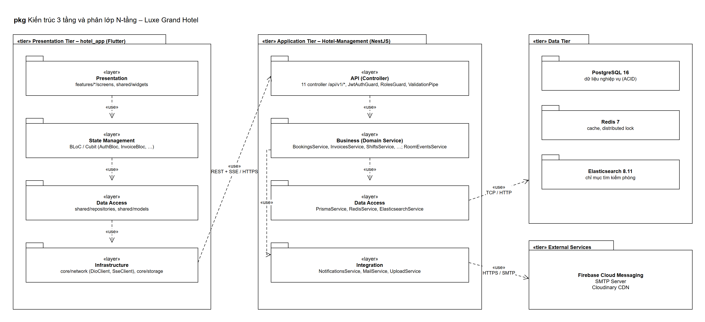

*Hình 2.1: Kiến trúc 3 tầng và phân lớp N-tầng của hệ thống*

Ở tầng ứng dụng, máy chủ được tổ chức thành bốn lớp: **API** (Controller, Guard, ValidationPipe), **Business** (Service chứa nghiệp vụ), **Data Access** (PrismaService, RedisService, ElasticsearchService) và **Integration** (Mail, Upload, Notifications). Ứng dụng di động cũng chia lớp tương tự: Presentation → State Management (BLoC) → Data Access (Repository) → Infrastructure (DioClient, SseClient).

### 2.1.1. Biểu đồ gói

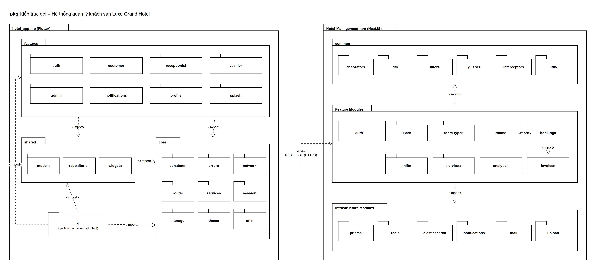

*Hình 2.2: Biểu đồ gói phân rã hệ thống*

Phía máy chủ `Hotel-Management::src` gồm ba nhóm gói phụ thuộc một chiều: **common** (decorators, dto, filters, guards, interceptors, utils) → **Feature Modules** (auth, users, room-types, rooms, bookings, invoices, services, shifts, analytics) → **Infrastructure Modules** (prisma, redis, elasticsearch, notifications, mail, upload). Phía ứng dụng `hotel_app::lib` tổ chức theo tính năng (auth, customer, receptionist, cashier, admin, notifications, profile, splash), dùng chung `shared` (models, repositories, widgets) và `core` (network, router, session, storage, theme…).

### 2.1.2. Biểu đồ thành phần

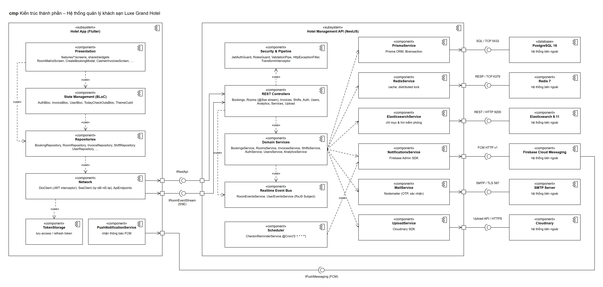

*Hình 2.3: Biểu đồ thành phần*

Hệ con **Hotel Management API** cung cấp hai giao diện cho ứng dụng: `IRestApi` (REST/JSON) và `IRoomEventStream` (SSE); ứng dụng nhận thông báo đẩy qua `IPushMessaging` (FCM). Bên trong, thành phần Security & Pipeline bao quanh REST Controllers; Controllers gọi Domain Services; Domain Services dùng các thành phần hạ tầng và phát sự kiện qua Realtime Event Bus (RoomEventsService, UserEventsService dựa trên RxJS Subject); Scheduler chạy tác vụ định kỳ.

**Ưu điểm của kiến trúc tách biệt:**

- **Độc lập phát triển:** backend và ứng dụng phát triển song song, chỉ cần thống nhất hợp đồng API (tài liệu Swagger và `API-CONTRACT.md`).
- **Dễ mở rộng:** có thể bổ sung web quản trị, kiosk tự check-in hay ứng dụng buồng phòng mà không thay đổi lõi backend.
- **Toàn vẹn dữ liệu:** mọi quy tắc nghiệp vụ – tính tiền, kiểm tra phòng trống, đối soát ca – nằm ở máy chủ; ứng dụng không thể bỏ qua các ràng buộc này.

## 2.2. Công nghệ phát triển phía Backend

### 2.2.1. TypeScript và NestJS

- **TypeScript:** bổ sung hệ thống kiểu tĩnh cho JavaScript, giúp phát hiện lỗi kiểu dữ liệu ngay khi biên dịch – đặc biệt hữu ích với các phép tính tiền và chuyển trạng thái phức tạp.
- **NestJS:** framework Node.js tổ chức mã nguồn theo module, lấy cảm hứng từ Angular:
  - **Module:** mỗi nghiệp vụ là một module độc lập (AuthModule, BookingsModule, InvoicesModule, ShiftsModule…) chứa Controller, Service, DTO riêng.
  - **Dependency Injection:** bộ chứa DI quản lý vòng đời và tiêm phụ thuộc giữa các lớp (ví dụ `BookingsService` nhận `PrismaService`, `RedisService`, `RoomEventsService`).
  - **Decorator, Guard, Pipe, Interceptor, Filter:** khai báo route (`@Get`, `@Post`), phân quyền (`@Roles`), kiểm tra dữ liệu vào (`ValidationPipe`), chuẩn hóa phản hồi (`TransformInterceptor`) và xử lý lỗi tập trung (`AllExceptionsFilter`).

### 2.2.2. PostgreSQL và Prisma ORM

- **PostgreSQL 16:** hệ quản trị CSDL quan hệ mã nguồn mở, hỗ trợ đầy đủ ACID, chỉ mục B-Tree và giao dịch nhiều câu lệnh.
- **Prisma ORM:**
  - **`schema.prisma`:** khai báo mô hình dữ liệu (10 model, 9 enum), quan hệ, chỉ mục; sinh client có kiểu tĩnh.
  - **Truy vấn có kiểu:** trình biên dịch TypeScript biết chính xác kiểu dữ liệu trả về của từng truy vấn.
  - **`prisma.$transaction`:** thực thi nguyên tử nhiều thao tác – ví dụ cập nhật đơn, đổi trạng thái phòng và ghi sổ thu tiền khi check-out.
  - **Truy vấn tham số hóa:** giá trị đầu vào không được ghép chuỗi vào câu SQL, tránh lỗi SQL Injection.

### 2.2.3. Redis và Elasticsearch

- **Redis:** kho khóa – giá trị trong bộ nhớ, được dùng cho:
  - **Khóa phân tán** `lock:booking:room:{roomId}` khi đặt phòng, giải phóng bằng Lua script – bảo đảm tại một thời điểm chỉ một yêu cầu được xử lý cho một phòng.
  - **Bộ đệm** danh sách phòng trống (60 giây) và thông tin người dùng đã xác thực (30 giây); blacklist token khi đăng xuất; lưu thông báo trong ứng dụng.
  - Khi không kết nối được Redis, `RedisService` tự chuyển sang bộ nhớ trong tiến trình (in-memory fallback) để hệ thống vẫn chạy.
- **Elasticsearch:** đánh chỉ mục thông tin phòng (loại phòng, tiện nghi, giá) phục vụ tìm kiếm toàn văn có so khớp gần đúng (`GET /rooms/search`).

### 2.2.4. Xác thực, phân quyền và tác vụ định kỳ

- **JWT:** khi đăng nhập, máy chủ cấp **access token** (HS256, thời hạn cấu hình qua `JWT_EXPIRES_IN`, trên máy chủ triển khai là 1 ngày) chứa `sub`, `email`, `role`, `sid` và **refresh token** (7 ngày). Mỗi lần làm mới, refresh token cũ bị thu hồi và cấp cặp token mới (token rotation).
- **Một thiết bị cho mỗi khách hàng:** mã phiên `sid` trong token phải khớp `users.activeSessionId`; đăng nhập ở máy mới sẽ làm phiên máy cũ hết hiệu lực.
- **RBAC:** decorator `@Roles()` kết hợp `JwtAuthGuard` và `RolesGuard` kiểm tra quyền tại từng endpoint; `@Public()` đánh dấu API công khai.
- **NestJS Schedule:** `CheckinReminderService` chạy theo biểu thức cron `0 1 * * *` (múi giờ Asia/Ho_Chi_Minh), quét các đơn `CONFIRMED` có ngày nhận phòng hôm nay hoặc ngày mai và gửi thông báo nhắc lịch cho khách.

## 2.3. Công nghệ phát triển ứng dụng di động

### 2.3.1. Flutter và Dart

**Flutter** cho phép viết một mã nguồn Dart duy nhất và biên dịch ra mã máy cho cả Android và iOS. Flutter tự vẽ giao diện bằng engine đồ họa riêng (Skia/Impeller) thay vì dùng WebView, nên giao diện đồng nhất trên các nền tảng.

### 2.3.2. Quản lý trạng thái BLoC

Ứng dụng dùng thư viện `flutter_bloc` để tách giao diện khỏi logic nghiệp vụ. Hình 2.4 minh họa luồng dữ liệu của màn hình hóa đơn:

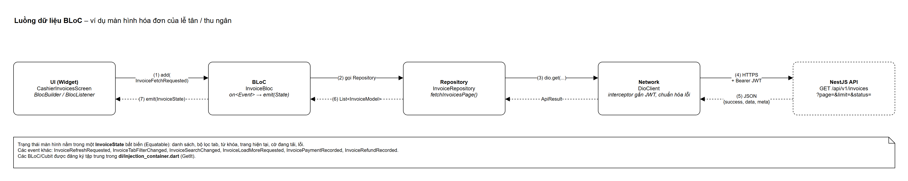

*Hình 2.4: Luồng dữ liệu BLoC trong ứng dụng Flutter (màn hình hóa đơn)*

- **Event:** hành động của người dùng, ví dụ `InvoiceFetchRequested`, `InvoiceSearchChanged`, `InvoicePaymentRecorded`.
- **BLoC:** nhận event, gọi Repository và phát ra State mới (`InvoiceBloc`, `AuthBloc`, `UserBloc`, `TodayCheckOutsBloc`).
- **State:** đối tượng bất biến (`Equatable`) mô tả dữ liệu đang hiển thị; giao diện dùng `BlocBuilder`/`BlocListener` để tự vẽ lại.

### 2.3.3. Dio, GetIt và GoRouter

- **Dio (`DioClient`):** gửi HTTP, interceptor tự gắn JWT, chuẩn hóa lỗi API thành `ApiError`; `SseClient` giữ kết nối SSE và tự kết nối lại.
- **GetIt:** đăng ký tập trung Repository, BLoC và các dịch vụ trong `di/injection_container.dart`.
- **GoRouter:** điều hướng khai báo, chuyển màn hình theo vai trò sau khi đăng nhập.
- **flutter_secure_storage:** lưu access/refresh token an toàn trên thiết bị.

### 2.3.4. Giao diện và trực quan hóa số liệu

- **FL Chart:** vẽ biểu đồ doanh thu và biểu đồ công suất ở màn hình báo cáo quản trị.
- **Bảng màu:** xanh navy đậm `#0F172A` làm nền điều hướng, vàng gold `#D97706` làm điểm nhấn thương hiệu, nền sáng `#F8FAFC` cho nội dung – theo định hướng “sang trọng, tin cậy, rõ ràng” từ nghiên cứu UI/UX.
- **Shimmer, flutter_animate:** hiệu ứng khung chờ tải và chuyển động nhẹ khi danh sách xuất hiện.

---

\newpage

# CHƯƠNG 3: PHÂN TÍCH VÀ THIẾT KẾ HỆ THỐNG

## 3.1. Đặc tả 27 yêu cầu chức năng (FR-01 đến FR-27)

Các yêu cầu chức năng được xác định từ kết quả khảo sát người dùng và chia thành 7 phân hệ.

### 3.1.1. Phân hệ Xác thực và tài khoản

- **[FR-01] Đăng ký tài khoản khách hàng:** khách nhập email, mật khẩu (tối thiểu 6 ký tự), họ tên, số điện thoại. Hệ thống kiểm tra email chưa tồn tại, băm mật khẩu bằng bcrypt (salt 10) và luôn gán vai trò `CUSTOMER` – trường `role` do client gửi lên bị bỏ qua.
- **[FR-02] Đăng nhập và cấp token:** xác thực email/mật khẩu, cấp access token và refresh token. Tài khoản khách hàng chỉ được đăng nhập trên một thiết bị; tài khoản bị vô hiệu hóa không đăng nhập được.
- **[FR-03] Khôi phục mật khẩu bằng OTP:** khách nhập email → hệ thống gửi mã OTP qua email (hiệu lực 15 phút) → khách xác thực OTP để nhận `resetToken` → đặt mật khẩu mới.

### 3.1.2. Phân hệ Danh mục phòng và sơ đồ phòng

- **[FR-04] Quản lý loại phòng:** quản trị viên thêm, sửa, xóa loại phòng gồm tên, mã, mô tả, giá cơ bản/đêm (`basePrice`), số người lớn và trẻ em tối đa, diện tích, tiện nghi và ảnh.
- **[FR-05] Quản lý phòng:** số phòng (duy nhất), tầng, loại phòng, ghi chú. Phòng do quản trị viên tạo được kích hoạt ngay; phòng do vai trò khác tạo ở trạng thái `PENDING_APPROVAL` chờ duyệt.
- **[FR-06] Sơ đồ phòng thời gian thực:** hiển thị phòng theo tầng với các trạng thái `AVAILABLE`, `RESERVED`, `OCCUPIED`, `CLEANING`, `MAINTENANCE`; mọi thay đổi trạng thái được đẩy tức thì tới các máy lễ tân qua luồng SSE `/rooms/stream`.

### 3.1.3. Phân hệ Đặt phòng và lưu trú

- **[FR-07] Tra cứu phòng trống:** khách chọn ngày nhận, ngày trả, số khách, loại phòng; hệ thống loại trừ các phòng có đơn `PENDING`, `CONFIRMED` hoặc `CHECKED_IN` giao với khoảng ngày cần đặt. Ngoài ra hỗ trợ tìm kiếm toàn văn theo tên, tiện nghi, khoảng giá.
- **[FR-08] Đặt phòng:** hệ thống chuẩn hóa giờ nhận phòng 14:00 và trả phòng 12:00, giữ khóa phân tán trên phòng, kiểm tra trùng lịch, tính tiền bằng số đêm × giá loại phòng và tạo đơn `PENDING` (khách đặt) hoặc `CONFIRMED` (lễ tân đặt hộ). Khách được tự hủy đơn khi đơn còn `PENDING`.
- **[FR-09] Phê duyệt và từ chối đơn:** lễ tân duyệt đơn (`CONFIRMED`), có thể ghi nhận tiền cọc (khi đó sinh hóa đơn kèm dòng thu loại `DEPOSIT`) và có thể xếp sang phòng khác nếu không trùng lịch; hoặc từ chối đơn (`CANCELLED`) kèm lý do. Khách nhận thông báo kết quả.
- **[FR-10] Nhận phòng (check-in) và khách vãng lai:** chỉ check-in đơn `CONFIRMED`; đơn chuyển `CHECKED_IN`, ghi `actualCheckIn`, phòng chuyển `OCCUPIED`. Khách vãng lai được lễ tân tạo đơn `CONFIRMED` rồi check-in ngay tại quầy.
- **[FR-11] Đổi phòng:** chỉ áp dụng cho đơn đang `CHECKED_IN`; phòng mới không được đang bảo trì, đang dọn, chờ duyệt hay trùng lịch. Phòng cũ chuyển `CLEANING`, phòng mới chuyển `OCCUPIED`.
- **[FR-12] Trả phòng (check-out):** tính bảng quyết toán (số đêm thực tế, phát hiện trả phòng trước hạn, tiền phòng, dịch vụ đã xác nhận, số đã thu, số còn phải thu); chỉ cho trả phòng khi thu đủ; ghi hóa đơn, dòng thu và dòng hoàn tiền (nếu trả sớm) trong một giao dịch; phòng chuyển `CLEANING`.

### 3.1.4. Phân hệ Dịch vụ khách sạn

- **[FR-13] Quản lý danh mục dịch vụ:** mã, tên, nhóm (ăn uống, chăm sóc sức khỏe, di chuyển, tiện ích, dịch vụ phòng), đơn giá, đơn vị, trạng thái khả dụng.
- **[FR-14] Dịch vụ phát sinh theo đơn:** lễ tân ghi nhận dịch vụ trực tiếp (trạng thái `CONFIRMED`), hoặc khách gửi yêu cầu gọi dịch vụ (`REQUESTED`) để lễ tân duyệt/từ chối. Đơn giá được sao chép vào đơn dịch vụ tại thời điểm gọi và được cộng vào quyết toán khi check-out.

### 3.1.5. Phân hệ Tài chính và ca trực

- **[FR-15] Sổ thu tiền nhiều đợt:** mỗi hóa đơn có nhiều dòng thu (`PAYMENT`, `DEPOSIT`, `REFUND`). `paidAmount` của hóa đơn luôn được tính lại bằng tổng các dòng `CONFIRMED` (thu cộng, hoàn trừ). Khách gửi yêu cầu chuyển khoản kèm mã giao dịch ở trạng thái `PENDING`; chỉ được cộng vào hóa đơn sau khi thu ngân xác nhận.
- **[FR-16] Quản lý ca trực:** mở ca với tiền mặt đầu ca (mỗi nhân viên tối đa một ca đang mở); mọi khoản thu/hoàn trong ca được gắn mã ca. Khi chốt ca, hệ thống tính `expectedCash` = tiền đầu ca + tiền mặt thu − tiền mặt hoàn, so với số tiền thực đếm `actualCash`; nếu lệch bắt buộc nhập lý do giải trình.

### 3.1.6. Phân hệ Báo cáo và tự động hóa

- **[FR-17] Dashboard điều hành:** tỷ lệ lấp đầy, số phòng theo trạng thái, doanh thu hôm nay so với hôm qua, lượt nhận và trả phòng hôm nay, số đơn chờ duyệt, số hóa đơn chưa thanh toán, doanh thu theo ngày.
- **[FR-18] Báo cáo doanh thu theo năm:** doanh thu 12 tháng tách tiền phòng và tiền dịch vụ, danh sách các năm có doanh thu, xuất báo cáo CSV.
- **[FR-19] Nhắc lịch nhận phòng tự động:** tác vụ định kỳ chạy hằng ngày, quét các đơn `CONFIRMED` nhận phòng hôm nay hoặc ngày mai và gửi thông báo cho khách.

### 3.1.7. Các chức năng quản trị và mở rộng

- **[FR-20] Quản lý tài khoản và phân quyền:** quản trị viên tạo tài khoản nhân viên, cập nhật thông tin và vai trò, đặt lại mật khẩu, vô hiệu hóa tài khoản (xóa mềm); danh sách tài khoản cập nhật realtime qua SSE.
- **[FR-21] Hồ sơ cá nhân:** xem và cập nhật họ tên, số điện thoại, ảnh đại diện; đổi mật khẩu.
- **[FR-22] Thông báo:** danh sách thông báo trong ứng dụng, đánh dấu đã đọc từng thông báo hoặc tất cả; lưu FCM token của thiết bị để nhận thông báo đẩy.
- **[FR-23] Hiệu suất nhân viên và doanh thu theo ngày:** thống kê theo nhân viên; doanh thu theo các khoảng 7/30/90/365 ngày.
- **[FR-24] Xem trước quyết toán:** trả bảng quyết toán của đơn đang lưu trú mà không thay đổi dữ liệu, dùng chung công thức với check-out.
- **[FR-25] Lịch sử ca trực:** tra cứu các ca đã chốt (lọc, phân trang), xem chi tiết từng ca; quản trị viên chốt hộ ca của nhân viên.
- **[FR-26] Từ chối thanh toán:** thu ngân từ chối yêu cầu chuyển khoản chưa thấy tiền về, kèm lý do; khoản này không bao giờ được tính tiền.
- **[FR-27] Đồng bộ trạng thái phòng và tải ảnh:** API rà soát lại trạng thái phòng theo lịch đặt hiện hành; tải ảnh đại diện, ảnh phòng lên Cloudinary/Supabase (dự phòng lưu cục bộ).

## 3.2. Yêu cầu phi chức năng

1. **Hiệu năng:**
   - Phân trang phía máy chủ cho mọi danh sách (tối đa 100 bản ghi/trang); chỉ mục trên các cột lọc thường dùng; bộ đệm cho danh sách phòng trống và thông tin xác thực; nén gzip phản hồi.
   - Kết quả đo thực tế được trình bày ở mục 5.4.
2. **Toàn vẹn dữ liệu:**
   - Không để hai đơn còn hiệu lực trùng lịch trên cùng một phòng, kể cả khi nhiều người đặt cùng lúc (khóa phân tán + kiểm tra giao lịch).
   - Thao tác nhiều bảng (check-in, check-out, duyệt đơn có cọc, chốt ca) thực hiện trong giao dịch CSDL.
   - Số đã thu và số còn nợ của hóa đơn luôn được tính từ sổ thu tiền.
3. **Bảo mật:**
   - Mật khẩu băm bcrypt; xác thực JWT; phân quyền theo vai trò ở từng API; dữ liệu đầu vào được kiểm tra bằng DTO và loại bỏ trường lạ.
   - Truyền tải qua HTTPS (máy chủ triển khai trên Render cung cấp TLS).
4. **Tính dễ dùng:**
   - Giao diện tiếng Việt, thông báo lỗi tiếng Việt rõ nguyên nhân; các thao tác lễ tân thường dùng có nút thao tác nhanh trên sơ đồ phòng.
5. **Khả năng bảo trì và triển khai:**
   - Mã nguồn phân module, phân tầng; tài liệu API Swagger tại `/api/docs`; đóng gói Docker, cấu hình qua biến môi trường.

## 3.3. Ma trận truy vết yêu cầu

*Bảng 3.1: Ma trận truy vết 27 yêu cầu chức năng*

| Mã YC | Yêu cầu | Vai trò | API chính | Bảng CSDL |
| :---: | :--- | :--- | :--- | :--- |
| FR-01 | Đăng ký tài khoản | Khách vãng lai | `POST /auth/register` | `users` |
| FR-02 | Đăng nhập, cấp token | Tất cả | `POST /auth/login`, `POST /auth/refresh-token`, `POST /auth/logout` | `users` |
| FR-03 | Khôi phục mật khẩu OTP | Tất cả | `POST /auth/forgot-password`, `/verify-reset-otp`, `/reset-password` | `password_resets` |
| FR-04 | Quản lý loại phòng | Admin | `GET, POST, PATCH, DELETE /room-types` | `room_types` |
| FR-05 | Quản lý phòng | Admin, Lễ tân | `POST /rooms`, `PATCH /rooms/{id}/approve`, `/reject`, `PUT, PATCH, DELETE /rooms/{id}` | `rooms` |
| FR-06 | Sơ đồ phòng realtime | Lễ tân, Admin | `GET /rooms`, `GET /rooms/stream` (SSE) | `rooms`, `bookings` |
| FR-07 | Tra cứu phòng trống | Tất cả | `GET /rooms/available`, `GET /rooms/search` | `rooms`, `bookings` |
| FR-08 | Đặt phòng, hủy đơn | Khách hàng, Lễ tân | `POST /bookings`, `PATCH /bookings/{id}/cancel` | `bookings` |
| FR-09 | Duyệt / từ chối đơn | Lễ tân, Admin | `PATCH /bookings/{id}/approve`, `PATCH /bookings/{id}/reject` | `bookings`, `invoices`, `payments` |
| FR-10 | Check-in, khách vãng lai | Lễ tân, Admin | `POST /bookings`, `POST /bookings/{id}/check-in` | `bookings`, `rooms` |
| FR-11 | Đổi phòng | Lễ tân, Admin | `POST /bookings/{id}/change-room` | `bookings`, `rooms` |
| FR-12 | Check-out, quyết toán | Lễ tân, Admin | `POST /bookings/{id}/check-out` | `bookings`, `invoices`, `payments` |
| FR-13 | Danh mục dịch vụ | Admin | `GET, POST, PATCH, DELETE /services` | `hotel_services` |
| FR-14 | Dịch vụ phát sinh | Khách hàng, Lễ tân | `POST /bookings/{id}/services`, `POST /bookings/{id}/service-requests`, `PATCH /bookings/{id}/services/{orderId}` | `extra_service_orders` |
| FR-15 | Sổ thu tiền nhiều đợt | Khách hàng, Lễ tân | `POST /invoices/{id}/pay`, `POST /invoices/{id}/payment-requests`, `POST /invoices/payments/{id}/confirm` | `invoices`, `payments` |
| FR-16 | Ca trực, đối soát tiền két | Lễ tân | `POST /shifts/open`, `GET /shifts/current`, `POST /shifts/close` | `work_shifts`, `payments` |
| FR-17 | Dashboard điều hành | Admin, Lễ tân | `GET /analytics/dashboard` | `rooms`, `bookings`, `invoices` |
| FR-18 | Doanh thu theo năm | Admin | `GET /analytics/revenue`, `/revenue/years`, `/revenue/export` | `invoices`, `payments` |
| FR-19 | Nhắc lịch nhận phòng | Bộ lập lịch | Cron `0 1 * * *` (`CheckinReminderService`) | `bookings`, `users` |
| FR-20 | Quản lý tài khoản | Admin | `GET, POST /users`, `PATCH, DELETE /users/{id}`, `GET /users/stream` | `users` |
| FR-21 | Hồ sơ cá nhân | Tất cả | `GET /auth/me`, `PATCH /users/me`, `POST /auth/change-password`, `POST /upload/avatar` | `users` |
| FR-22 | Thông báo | Tất cả | `GET /notifications`, `PATCH /notifications/{id}/read`, `PATCH /users/fcm-token` | Redis (danh sách thông báo), `users.fcmToken` |
| FR-23 | Hiệu suất nhân viên, doanh thu ngày | Admin, Lễ tân | `GET /analytics/staff-performance`, `GET /analytics/revenue/daily` | `payments`, `work_shifts` |
| FR-24 | Xem trước quyết toán | Lễ tân, Admin | `GET /bookings/{id}/checkout-preview` | `bookings`, `invoices` |
| FR-25 | Lịch sử ca, chốt hộ ca | Admin, Lễ tân | `GET /shifts`, `GET /shifts/{id}`, `POST /shifts/{id}/close` | `work_shifts`, `payments` |
| FR-26 | Từ chối thanh toán | Lễ tân, Admin | `POST /invoices/payments/{id}/reject` | `payments`, `invoices` |
| FR-27 | Đồng bộ trạng thái phòng, tải ảnh | Lễ tân, Admin | `POST /rooms/sync-status`, `POST /upload/*` | `rooms` |

## 3.4. Sơ đồ Use Case tổng thể

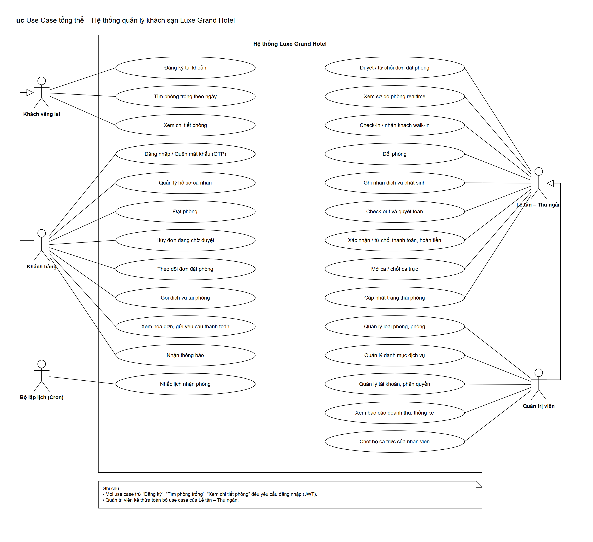

*Hình 3.1: Sơ đồ Use Case tổng thể của hệ thống*

Sơ đồ gồm 5 tác nhân. **Khách hàng** kế thừa các use case của **Khách vãng lai** (tìm phòng, xem chi tiết, đăng ký); **Quản trị viên** kế thừa toàn bộ use case của **Lễ tân – Thu ngân** và có thêm các use case quản trị danh mục, tài khoản, báo cáo. **Bộ lập lịch (Cron)** là tác nhân hệ thống thực hiện nhắc lịch nhận phòng.

## 3.5. Thiết kế sơ đồ tuần tự, sơ đồ hoạt động và thuật toán nghiệp vụ lõi

### 3.5.1. Quy trình đặt phòng, phê duyệt và check-in

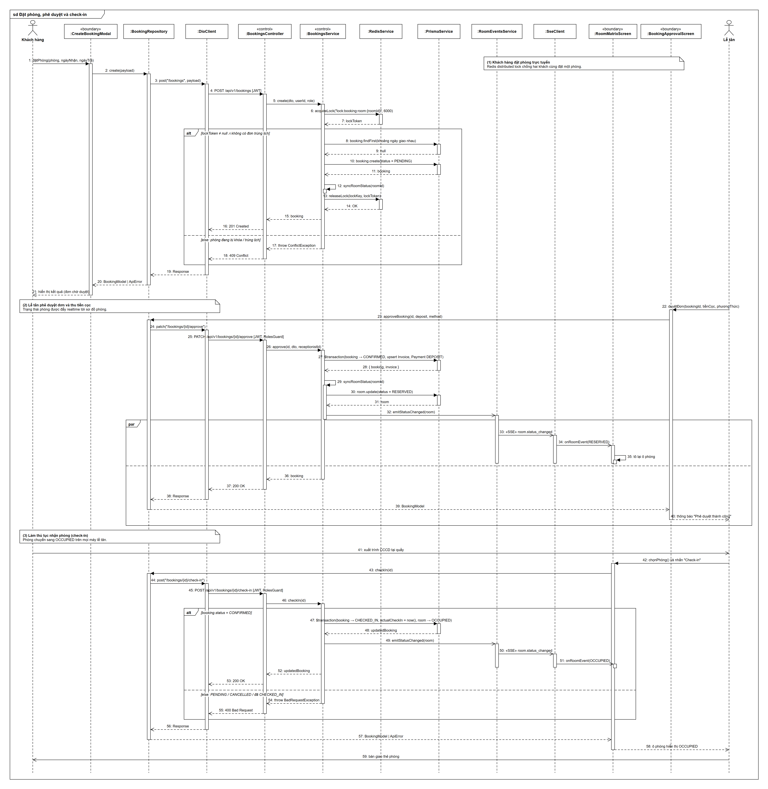

*Hình 3.2: Sơ đồ tuần tự quy trình đặt phòng, phê duyệt và check-in*

Sơ đồ mô tả ba giai đoạn đi qua tất cả các lớp của hệ thống:

1. **Khách đặt phòng:** `CreateBookingModal` → `BookingRepository` → `DioClient` gửi `POST /api/v1/bookings`. `BookingsController` chuyển cho `BookingsService`; Service giữ khóa Redis trên phòng, kiểm tra trùng lịch, tạo đơn `PENDING`, nhả khóa và trả `201 Created`. Nếu không giữ được khóa hoặc trùng lịch, trả `409 Conflict`.
2. **Lễ tân duyệt đơn:** `PATCH /bookings/{id}/approve` đi qua `JwtAuthGuard`, `RolesGuard`; trong một giao dịch đơn chuyển `CONFIRMED` và ghi tiền cọc; trạng thái phòng được đồng bộ và đẩy qua SSE tới sơ đồ phòng của mọi máy lễ tân.
3. **Check-in:** `POST /bookings/{id}/check-in`; nếu đơn `CONFIRMED` thì trong một giao dịch đơn chuyển `CHECKED_IN` và phòng chuyển `OCCUPIED`; ngược lại trả `400 Bad Request`.

### 3.5.2. Quy trình check-in, đổi phòng và check-out

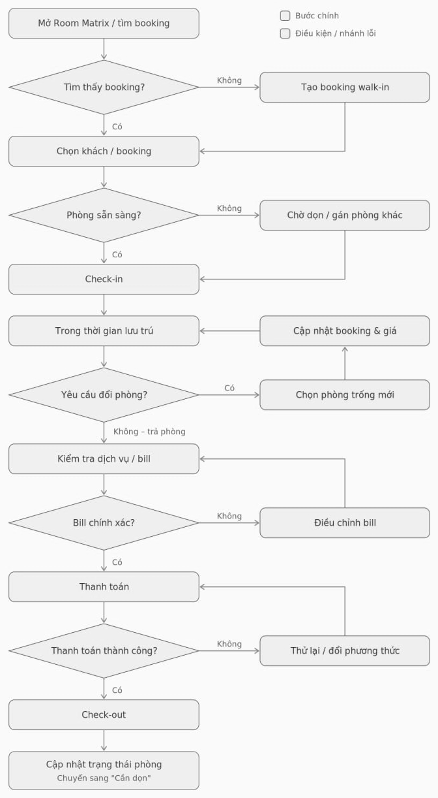

*Hình 3.3: Sơ đồ hoạt động quy trình check-in, đổi phòng và check-out của lễ tân*

*Bảng 3.2: Ánh xạ các bước của quy trình lưu trú sang API*

| Bước | API | Ràng buộc phía máy chủ |
| :--- | :--- | :--- |
| Mở sơ đồ phòng / tìm booking | `GET /rooms` + SSE `/rooms/stream`; `GET /bookings?search=` | Trạng thái phòng đẩy realtime |
| Không thấy booking → tạo walk-in | `POST /bookings` (lễ tân tạo đơn `CONFIRMED`) | Vẫn kiểm tra trùng lịch |
| Check-in | `POST /bookings/{id}/check-in` | Chỉ đơn `CONFIRMED`; phòng → `OCCUPIED` |
| Đổi phòng | `POST /bookings/{id}/change-room` | Phòng mới hợp lệ; phòng cũ → `CLEANING` |
| Kiểm tra dịch vụ / bill | `POST /bookings/{id}/services`, `GET /bookings/{id}/checkout-preview` | Cùng công thức với check-out |
| Thanh toán và check-out | `POST /bookings/{id}/check-out` | Phải thu đủ; phòng → `CLEANING` |

### 3.5.3. Quy trình quản lý ca trực và đối soát tiền két

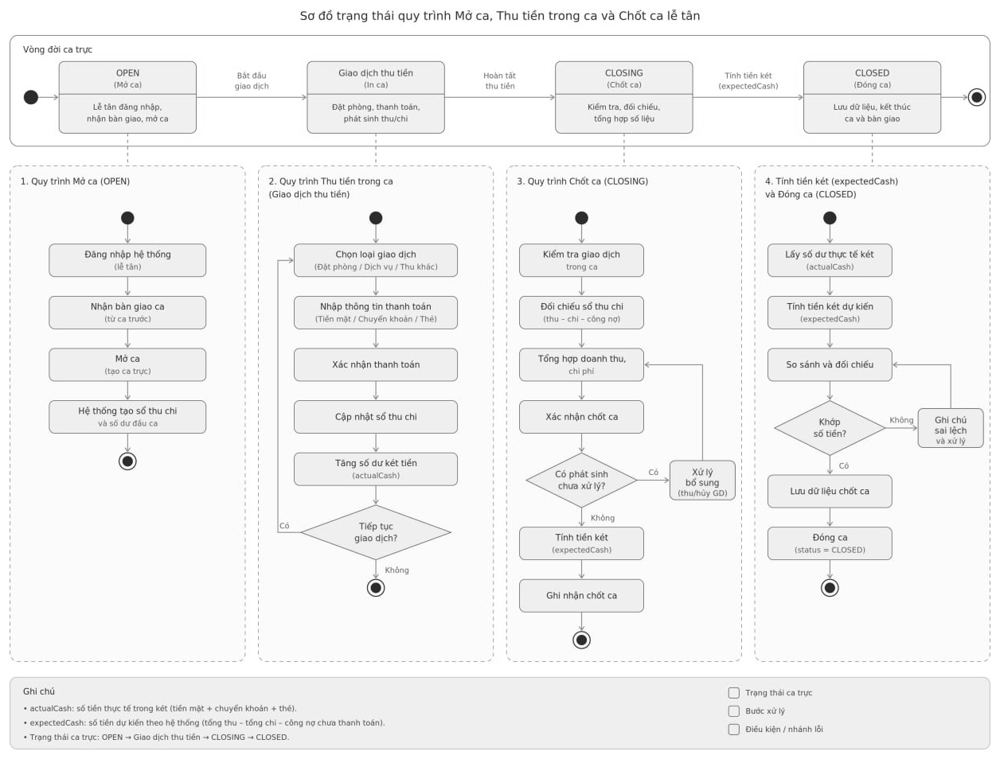

*Hình 3.4: Sơ đồ trạng thái quy trình mở ca, thu tiền trong ca và chốt ca*

Sơ đồ chia vòng đời ca trực thành bốn giai đoạn OPEN → giao dịch thu tiền → CLOSING → CLOSED. Ở máy chủ, ca trực lưu hai trạng thái bền vững `OPEN` và `CLOSED`: giai đoạn thu tiền tương ứng các dòng `payments` được gắn `shiftId` của ca đang mở; giai đoạn CLOSING là bước đối chiếu trên giao diện (`GET /shifts/current` trả về `expectedCash`) trước khi gọi `POST /shifts/close`.

### 3.5.4. Thuật toán chống đặt trùng phòng

Hai khoảng lưu trú `[checkIn, checkOut)` của đơn mới và `[C_in, C_out)` của một đơn đã có trên cùng phòng **xung đột** khi và chỉ khi:

> checkIn < C_out **và** checkOut > C_in

Điều kiện này chỉ áp dụng cho các đơn còn hiệu lực (`PENDING`, `CONFIRMED`, `CHECKED_IN`). Vì giờ nhận phòng được chuẩn hóa 14:00 và giờ trả 12:00, khách trả phòng sáng nay và khách mới nhận phòng chiều nay không bị coi là trùng.

Kiểm tra giao lịch đơn thuần vẫn có thể sai khi hai yêu cầu đến cùng lúc: cả hai cùng đọc thấy “chưa có đơn” rồi cùng tạo đơn. Hệ thống vì vậy bọc toàn bộ thao tác trong một **khóa phân tán theo phòng**:

```typescript
const lockKey = `lock:booking:room:${dto.roomId}`;
const lockToken = await this.redis.acquireLock(lockKey, 6000); // SET NX PX 6000
if (!lockToken) {
  throw new ConflictException('Phòng này đang được khách khác giữ chỗ để thanh toán, vui lòng thử lại sau giây lát!');
}
try {
  const conflictBooking = await this.prisma.booking.findFirst({
    where: {
      roomId: dto.roomId,
      status: { in: [BookingStatus.PENDING, BookingStatus.CONFIRMED, BookingStatus.CHECKED_IN] },
      checkOutDate: { gt: now },
      AND: [{ checkInDate: { lt: checkOut } }, { checkOutDate: { gt: checkIn } }],
    },
  });
  if (conflictBooking) {
    throw new ConflictException('Phòng này đã có khách đặt hoặc đang ở trong khoảng thời gian được chọn');
  }
  // ... tính tiền, tạo đơn
} finally {
  await this.redis.releaseLock(lockKey, lockToken); // Lua script: chỉ xóa khóa nếu đúng token
}
```

Hiệu quả của cơ chế này được kiểm chứng bằng kiểm thử đặt phòng đồng thời ở mục 5.3.

### 3.5.5. Máy trạng thái của đơn đặt phòng và phòng

*Bảng 3.3: Chuyển trạng thái đơn đặt phòng*

| Từ | Sang | Sự kiện / API | Tác động lên phòng |
| :--- | :--- | :--- | :--- |
| — | PENDING | Khách `POST /bookings` | Không chiếm phòng |
| — | CONFIRMED | Lễ tân đặt hộ `POST /bookings` | RESERVED nếu nhận phòng trong hôm nay |
| PENDING | CONFIRMED | `PATCH /bookings/{id}/approve` hoặc `/confirm` | RESERVED nếu nhận phòng trong hôm nay |
| PENDING, CONFIRMED | CANCELLED | `PATCH /bookings/{id}/reject` hoặc `/cancel` | Suy diễn lại theo các đơn còn lại |
| CONFIRMED | CHECKED_IN | `POST /bookings/{id}/check-in` | OCCUPIED |
| CHECKED_IN | CHECKED_OUT | `POST /bookings/{id}/check-out` | CLEANING |

*Bảng 3.4: Chuyển trạng thái phòng*

| Từ | Sang | Sự kiện / API |
| :--- | :--- | :--- |
| PENDING_APPROVAL | AVAILABLE / REJECTED | `PATCH /rooms/{id}/approve` hoặc `/reject` |
| AVAILABLE | RESERVED | Có đơn CONFIRMED nhận phòng trong hôm nay |
| AVAILABLE, RESERVED | OCCUPIED | Check-in |
| OCCUPIED | CLEANING | Check-out; phòng cũ khi đổi phòng |
| CLEANING | AVAILABLE | `PATCH /rooms/{id}/status` khi buồng phòng dọn xong |
| Bất kỳ (không có khách đang ở) | MAINTENANCE | `PATCH /rooms/{id}/status` |

## 3.6. Thiết kế cơ sở dữ liệu

### 3.6.1. Biểu đồ lớp và quan hệ thực thể

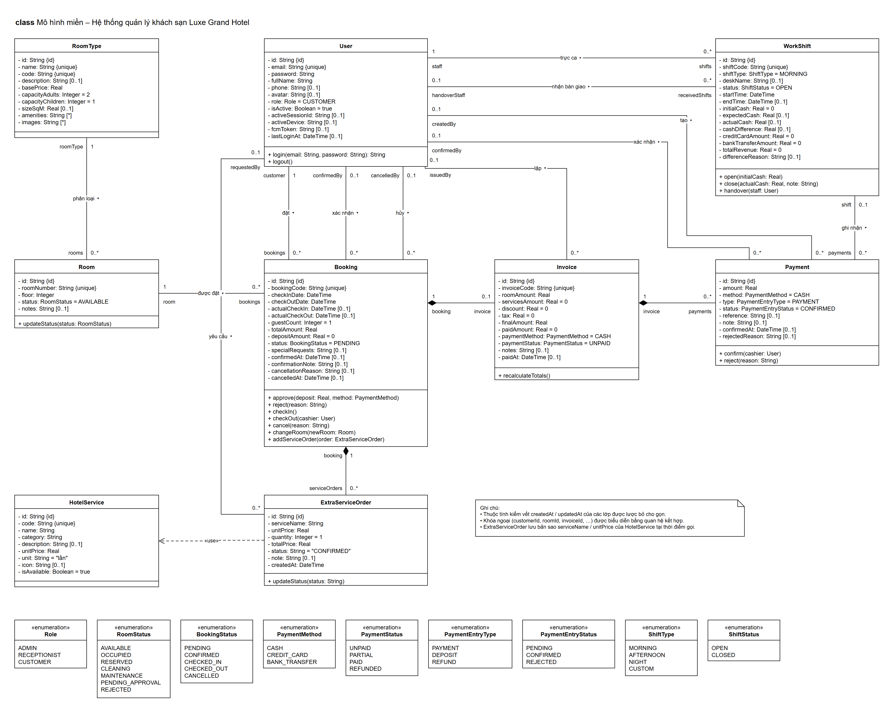

*Hình 3.5: Biểu đồ lớp mô hình miền (tương ứng sơ đồ quan hệ thực thể)*

Cơ sở dữ liệu gồm **10 bảng** sinh từ `prisma/schema.prisma`: `users`, `room_types`, `rooms`, `bookings`, `invoices`, `payments`, `extra_service_orders`, `hotel_services`, `work_shifts`, `password_resets`. Khóa chính dạng UUID; các cột dùng để lọc (trạng thái, ngày, khóa ngoại) đều có chỉ mục. Thông báo trong ứng dụng không lưu bảng riêng mà lưu trong Redis (hết hạn sau 7 ngày) và được tổng hợp từ đơn đặt phòng, hóa đơn.

### 3.6.2. Liên kết khóa chính – khóa ngoại

*Bảng 3.5: Liên kết khóa chính – khóa ngoại và ràng buộc toàn vẹn*

| STT | Bảng con | Khóa ngoại | Bảng cha | Quan hệ | Khi xóa bản ghi cha | Ý nghĩa |
| :---: | :--- | :--- | :--- | :---: | :--- | :--- |
| 1 | `rooms` | `roomTypeId` | `room_types` | N – 1 | RESTRICT | Mỗi phòng thuộc một loại phòng |
| 2 | `bookings` | `customerId` | `users` | N – 1 | RESTRICT | Khách hàng sở hữu đơn |
| 3 | `bookings` | `roomId` | `rooms` | N – 1 | RESTRICT | Phòng được xếp cho đơn |
| 4 | `bookings` | `confirmedById` | `users` | N – 0..1 | SET NULL | Nhân viên duyệt đơn |
| 5 | `bookings` | `cancelledById` | `users` | N – 0..1 | SET NULL | Người hủy / từ chối đơn |
| 6 | `invoices` | `bookingId` (duy nhất) | `bookings` | 1 – 1 | CASCADE | Mỗi đơn có tối đa một hóa đơn |
| 7 | `invoices` | `issuedById` | `users` | N – 0..1 | SET NULL | Thu ngân lập hóa đơn |
| 8 | `payments` | `invoiceId` | `invoices` | N – 1 | CASCADE | Các dòng thu / cọc / hoàn của hóa đơn |
| 9 | `payments` | `createdById` | `users` | N – 0..1 | SET NULL | Người tạo dòng thu |
| 10 | `payments` | `confirmedById` | `users` | N – 0..1 | SET NULL | Thu ngân xác nhận đã nhận tiền |
| 11 | `payments` | `shiftId` | `work_shifts` | N – 0..1 | SET NULL | Ca trực ghi nhận khoản thu |
| 12 | `work_shifts` | `staffId` | `users` | N – 1 | RESTRICT | Nhân viên trực ca |
| 13 | `work_shifts` | `handoverStaffId` | `users` | N – 0..1 | SET NULL | Nhân viên nhận bàn giao |
| 14 | `extra_service_orders` | `bookingId` | `bookings` | N – 1 | CASCADE | Dịch vụ phát sinh của đơn |
| 15 | `extra_service_orders` | `requestedById` | `users` | N – 0..1 | SET NULL | Người yêu cầu dịch vụ |

### 3.6.3. Từ điển dữ liệu

*Bảng 3.6: Bảng `users`*

| Trường | Kiểu | Khóa / Ràng buộc | Mô tả |
| :--- | :--- | :--- | :--- |
| `id` | UUID | PK | Mã người dùng |
| `email` | String | Unique | Email đăng nhập |
| `password` | String | | Mật khẩu đã băm bcrypt |
| `fullName`, `phone`, `avatar` | String | `phone`, `avatar` có thể null | Thông tin cá nhân, URL ảnh đại diện |
| `role` | Enum `Role` | Index, mặc định `CUSTOMER` | `ADMIN`, `RECEPTIONIST`, `CUSTOMER` |
| `isActive` | Boolean | Index, mặc định `true` | `false` khi tài khoản bị vô hiệu hóa |
| `activeSessionId`, `activeDevice` | String | Có thể null | Phiên đăng nhập đang hiệu lực (một thiết bị cho khách hàng) |
| `fcmToken`, `lastLoginAt` | String, DateTime | Có thể null | Token nhận thông báo đẩy, lần đăng nhập gần nhất |
| `createdAt`, `updatedAt` | DateTime | | Thời điểm tạo / cập nhật |

*Bảng 3.7: Bảng `room_types`*

| Trường | Kiểu | Khóa / Ràng buộc | Mô tả |
| :--- | :--- | :--- | :--- |
| `id` | UUID | PK | Mã loại phòng |
| `name`, `code` | String | Unique | Tên và mã loại phòng (ví dụ `STD-S`) |
| `description` | String | Có thể null | Mô tả |
| `basePrice` | Float | | Giá cơ bản một đêm (VND) |
| `capacityAdults`, `capacityChildren` | Int | Mặc định 2 và 1 | Số người lớn / trẻ em tối đa |
| `sizeSqM` | Float | Có thể null | Diện tích (m²) |
| `amenities`, `images` | String[] | | Danh sách tiện nghi, URL ảnh |

*Bảng 3.8: Bảng `rooms`*

| Trường | Kiểu | Khóa / Ràng buộc | Mô tả |
| :--- | :--- | :--- | :--- |
| `id` | UUID | PK | Mã phòng |
| `roomNumber` | String | Unique | Số phòng (101, 102…) |
| `floor` | Int | Index | Tầng |
| `roomTypeId` | UUID | FK, Index | Loại phòng |
| `status` | Enum `RoomStatus` | Index, mặc định `AVAILABLE` | `AVAILABLE`, `OCCUPIED`, `RESERVED`, `CLEANING`, `MAINTENANCE`, `PENDING_APPROVAL`, `REJECTED` |
| `notes` | String | Có thể null | Ghi chú nội bộ |

*Bảng 3.9: Bảng `bookings`*

| Trường | Kiểu | Khóa / Ràng buộc | Mô tả |
| :--- | :--- | :--- | :--- |
| `id` | UUID | PK | Mã đơn |
| `bookingCode` | String | Unique | Mã hiển thị, ví dụ `BK-07341472` |
| `customerId`, `roomId` | UUID | FK, Index | Khách hàng và phòng |
| `checkInDate`, `checkOutDate` | DateTime | Index | Ngày nhận (14:00) và trả (12:00) dự kiến |
| `actualCheckIn`, `actualCheckOut` | DateTime | Có thể null | Thời điểm nhận / trả phòng thực tế |
| `guestCount` | Int | Mặc định 1 | Số khách |
| `totalAmount`, `depositAmount` | Float | | Tiền phòng dự kiến, tiền cọc |
| `status` | Enum `BookingStatus` | Index, mặc định `PENDING` | `PENDING`, `CONFIRMED`, `CHECKED_IN`, `CHECKED_OUT`, `CANCELLED` |
| `specialRequests` | String | Có thể null | Yêu cầu đặc biệt, ghi chú trả phòng sớm |
| `confirmedAt`, `confirmedById`, `confirmationNote` | | Có thể null | Dấu vết duyệt đơn |
| `cancellationReason`, `cancelledAt`, `cancelledById` | | Có thể null | Dấu vết hủy / từ chối đơn |

Bảng `bookings` có thêm chỉ mục kết hợp `(roomId, status)` và `(customerId, status)` phục vụ kiểm tra trùng lịch và màn hình “Đơn của tôi”.

*Bảng 3.10: Bảng `invoices`*

| Trường | Kiểu | Khóa / Ràng buộc | Mô tả |
| :--- | :--- | :--- | :--- |
| `id` | UUID | PK | Mã hóa đơn |
| `invoiceCode` | String | Unique | Ví dụ `INV-07341472` |
| `bookingId` | UUID | FK, Unique | Đơn đặt phòng (1 – 1) |
| `roomAmount`, `servicesAmount`, `discount`, `tax` | Float | | Tiền phòng, dịch vụ, giảm giá, thuế |
| `finalAmount` | Float | | Tổng phải trả |
| `paidAmount` | Float | Mặc định 0 | Tính lại từ tổng các dòng `payments` đã xác nhận |
| `paymentMethod` | Enum | Mặc định `CASH` | `CASH`, `CREDIT_CARD`, `BANK_TRANSFER` |
| `paymentStatus` | Enum | Index | `UNPAID`, `PARTIAL`, `PAID`, `REFUNDED` |
| `issuedById`, `notes`, `paidAt` | | Có thể null | Người lập, ghi chú, thời điểm thanh toán đủ |

*Bảng 3.11: Bảng `payments` (sổ thu tiền)*

| Trường | Kiểu | Khóa / Ràng buộc | Mô tả |
| :--- | :--- | :--- | :--- |
| `id` | UUID | PK | Mã dòng thu |
| `invoiceId` | UUID | FK, Index | Hóa đơn |
| `amount` | Float | | Số tiền |
| `method` | Enum `PaymentMethod` | | Phương thức |
| `type` | Enum `PaymentEntryType` | | `PAYMENT`, `DEPOSIT`, `REFUND` |
| `status` | Enum `PaymentEntryStatus` | Index, mặc định `CONFIRMED` | `PENDING` (khách báo đã chuyển), `CONFIRMED`, `REJECTED` |
| `reference`, `note`, `rejectedReason` | String | Có thể null | Mã giao dịch ngân hàng, ghi chú, lý do từ chối |
| `createdById`, `confirmedById`, `confirmedAt` | | Có thể null | Người tạo, người xác nhận, thời điểm xác nhận |
| `shiftId` | UUID | FK, Index | Ca trực ghi nhận |

*Bảng 3.12: Bảng `work_shifts`*

| Trường | Kiểu | Khóa / Ràng buộc | Mô tả |
| :--- | :--- | :--- | :--- |
| `id` | UUID | PK | Mã ca |
| `shiftCode` | String | Unique | `SFT-YYYYMMDD-XXXX` |
| `staffId` | UUID | FK, Index | Nhân viên trực |
| `shiftType` | Enum | Mặc định `MORNING` | `MORNING`, `AFTERNOON`, `NIGHT`, `CUSTOM` |
| `deskName` | String | Có thể null | Quầy / máy trực |
| `status` | Enum | Index | `OPEN`, `CLOSED` |
| `startTime`, `endTime` | DateTime | | Giờ mở / chốt ca |
| `initialCash`, `actualCash`, `expectedCash`, `cashDifference` | Float | | Tiền đầu ca, thực đếm, sổ sách, chênh lệch |
| `creditCardAmount`, `bankTransferAmount`, `totalRevenue` | Float | | Doanh thu thẻ, chuyển khoản, tổng trong ca |
| `openNote`, `closeNote`, `differenceReason` | String | Có thể null | Ghi chú và giải trình chênh lệch |
| `handoverStaffId` | UUID | FK | Nhân viên nhận bàn giao |

*Bảng 3.13: Bảng `extra_service_orders`, `hotel_services` và `password_resets`*

| Bảng | Trường chính | Mô tả |
| :--- | :--- | :--- |
| `extra_service_orders` | `id`, `bookingId` (FK), `serviceName`, `unitPrice`, `quantity`, `totalPrice`, `status` (`REQUESTED`, `CONFIRMED`, `REJECTED`), `requestedById`, `note` | Dịch vụ phát sinh của một đơn, lưu bản sao tên và đơn giá tại thời điểm gọi |
| `hotel_services` | `id`, `code` (Unique), `name`, `category`, `description`, `unitPrice`, `unit`, `icon`, `isAvailable` | Danh mục dịch vụ khách sạn |
| `password_resets` | `id`, `email` (Index), `otp`, `token` (Unique), `expiresAt`, `used` | Phiên khôi phục mật khẩu |

## 3.7. Thiết kế giao tiếp RESTful API

API dùng tiền tố `/api/v1`, tài nguyên là danh từ số nhiều (`/rooms`, `/bookings`, `/invoices`), các hành động chuyển trạng thái là tài nguyên con (`/bookings/{id}/check-in`). Mọi phản hồi có cùng cấu trúc `{ statusCode, success, message, data, timestamp }`; lỗi có thêm `error`, `errors` (danh sách lỗi validate) và `path`. Danh sách có phân trang trả `data` dạng `{ data: [...], meta: { total, page, limit, totalPages } }`. Toàn bộ 95 đường dẫn được tài liệu hóa bằng Swagger tại `/api/docs`; bảng dưới liệt kê các API cốt lõi.

*Bảng 3.14: Các API RESTful cốt lõi*

| Method | Endpoint | Quyền | Mô tả |
| :---: | :--- | :--- | :--- |
| POST | `/api/v1/auth/register` | Public | Đăng ký tài khoản khách hàng |
| POST | `/api/v1/auth/login` | Public | Đăng nhập, cấp access + refresh token |
| POST | `/api/v1/auth/refresh-token` | Public | Cấp cặp token mới |
| POST | `/api/v1/auth/forgot-password` | Public | Gửi OTP khôi phục mật khẩu |
| POST | `/api/v1/auth/reset-password` | Public | Đặt lại mật khẩu bằng resetToken / OTP |
| GET | `/api/v1/auth/me` | Đăng nhập | Thông tin tài khoản hiện tại |
| GET | `/api/v1/rooms` | Public | Danh sách / sơ đồ phòng, lọc tầng, trạng thái, loại; phân trang |
| GET | `/api/v1/rooms/stream` | Public (SSE) | Luồng sự kiện thay đổi trạng thái phòng |
| GET | `/api/v1/rooms/available` | Public | Phòng trống theo khoảng ngày |
| PATCH | `/api/v1/rooms/{id}/status` | Admin, Lễ tân | Cập nhật nhanh trạng thái phòng |
| POST | `/api/v1/bookings` | Đăng nhập | Đặt phòng (chống trùng lịch) |
| GET | `/api/v1/bookings` | Đăng nhập | Danh sách đơn: lọc trạng thái, ngày, tìm kiếm, phân trang |
| PATCH | `/api/v1/bookings/{id}/approve` | Admin, Lễ tân | Duyệt đơn, ghi nhận tiền cọc |
| PATCH | `/api/v1/bookings/{id}/reject` | Admin, Lễ tân | Từ chối đơn kèm lý do |
| PATCH | `/api/v1/bookings/{id}/cancel` | Đăng nhập | Hủy đơn (khách chỉ hủy được đơn chờ duyệt) |
| POST | `/api/v1/bookings/{id}/check-in` | Admin, Lễ tân | Nhận phòng |
| POST | `/api/v1/bookings/{id}/change-room` | Admin, Lễ tân | Đổi phòng cho khách đang ở |
| GET | `/api/v1/bookings/{id}/checkout-preview` | Admin, Lễ tân | Xem trước bảng quyết toán |
| POST | `/api/v1/bookings/{id}/check-out` | Admin, Lễ tân | Trả phòng, chốt hóa đơn, thu / hoàn tiền |
| POST | `/api/v1/invoices/{id}/pay` | Admin, Lễ tân | Thu tiền tại quầy |
| POST | `/api/v1/invoices/{id}/payment-requests` | Đăng nhập | Khách gửi yêu cầu thanh toán chuyển khoản |
| POST | `/api/v1/invoices/payments/{id}/confirm` | Admin, Lễ tân | Xác nhận đã nhận tiền |
| POST | `/api/v1/invoices/payments/{id}/reject` | Admin, Lễ tân | Từ chối yêu cầu thanh toán |
| POST | `/api/v1/shifts/open` | Admin, Lễ tân | Mở ca trực |
| POST | `/api/v1/shifts/close` | Admin, Lễ tân | Chốt ca, đối soát tiền mặt |
| GET | `/api/v1/analytics/dashboard` | Admin, Lễ tân | Chỉ số điều hành hôm nay |
| GET | `/api/v1/analytics/revenue` | Admin | Doanh thu 12 tháng theo năm |

---

\newpage

# CHƯƠNG 4: HIỆN THỰC HÓA VÀ GIAO DIỆN HỆ THỐNG

## 4.1. Hiện thực hóa Backend (NestJS)

### 4.1.1. Cấu trúc mã nguồn

Mã nguồn máy chủ (`Hotel-Management`, khoảng 16.400 dòng TypeScript, 11 controller, 18 service, 45 lớp DTO) được tổ chức theo module:

```
Hotel-Management/
├── prisma/
│   ├── schema.prisma      # 10 model, 9 enum, quan hệ và chỉ mục
│   ├── migrations/        # Lịch sử thay đổi cấu trúc CSDL
│   └── seed.ts            # Dữ liệu mẫu: tài khoản, loại phòng, phòng, dịch vụ
└── src/
    ├── main.ts            # Prefix /api/v1, CORS, ValidationPipe, Swagger, gzip
    ├── app.module.ts      # Module gốc
    ├── common/            # decorators, dto, filters, guards, interceptors, utils
    ├── auth/              # Đăng ký, đăng nhập, JWT, OTP, chính sách 1 thiết bị
    ├── users/             # Tài khoản, hồ sơ cá nhân, SSE danh sách tài khoản
    ├── room-types/        # Loại phòng
    ├── rooms/             # Phòng, phòng trống, tìm kiếm, SSE trạng thái phòng
    ├── bookings/          # Đặt phòng, duyệt, check-in, đổi phòng, check-out
    ├── invoices/          # Hóa đơn, sổ thu tiền, yêu cầu thanh toán, hoàn tiền
    ├── services/          # Danh mục dịch vụ khách sạn
    ├── shifts/            # Mở / chốt ca trực, đối soát tiền mặt
    ├── analytics/         # Dashboard, doanh thu, công suất, hiệu suất nhân viên
    ├── notifications/     # Thông báo, FCM, cron nhắc lịch nhận phòng
    ├── prisma/  redis/  elasticsearch/   # Hạ tầng dữ liệu
    └── mail/  upload/     # Gửi email OTP, tải ảnh lên Cloudinary / Supabase
```

Mỗi module nghiệp vụ theo cùng một khuôn: `*.controller.ts` nhận request và gọi Service, `*.service.ts` chứa nghiệp vụ, `dto/*.dto.ts` mô tả và kiểm tra dữ liệu vào, `*.module.ts` khai báo phụ thuộc.

### 4.1.2. Xác thực và phân quyền

Quyền truy cập được khai báo bằng decorator ngay trên route; `RolesGuard` đọc danh sách vai trò yêu cầu và so với vai trò trong token:

```typescript
@Injectable()
export class RolesGuard implements CanActivate {
  constructor(private reflector: Reflector) {}

  canActivate(context: ExecutionContext): boolean {
    const requiredRoles = this.reflector.getAllAndOverride<Role[]>(ROLES_KEY, [
      context.getHandler(),
      context.getClass(),
    ]);
    if (!requiredRoles || requiredRoles.length === 0) {
      return true;
    }
    const { user } = context.switchToHttp().getRequest();
    if (!user) {
      throw new ForbiddenException('User is not authenticated');
    }
    const hasRole = requiredRoles.some((role) => user.role === role);
    if (!hasRole) {
      throw new ForbiddenException(`Quyền truy cập bị từ chối: Yêu cầu vai trò [${requiredRoles.join(', ')}]`);
    }
    return true;
  }
}
```

`JwtStrategy.validate()` ngoài kiểm tra chữ ký còn kiểm tra token có trong blacklist đăng xuất không, tài khoản còn hoạt động không, và với tài khoản khách hàng thì mã phiên `sid` trong token phải khớp `activeSessionId` đang lưu.

Mọi phản hồi thành công được chuẩn hóa bởi `TransformInterceptor`:

```typescript
return next.handle().pipe(
  map((data) => {
    let message = 'Thành công';
    if (data && typeof data === 'object' && !Array.isArray(data) && typeof data.message === 'string') {
      message = data.message;
    }
    return { statusCode, success: true, message, data: data !== undefined ? data : null, timestamp: new Date().toISOString() };
  }),
);
```

Còn mọi lỗi (HttpException, lỗi Prisma như trùng khóa `P2002` → 409, không tìm thấy `P2025` → 404, lỗi bất ngờ → 500) được `AllExceptionsFilter` chuyển thành cùng cấu trúc JSON với thông điệp tiếng Việt.

### 4.1.3. Module đặt phòng

`BookingsController` chỉ nhận DTO đã được kiểm tra và chuyển cho Service; khách hàng luôn bị giới hạn về đơn của chính mình:

```typescript
@Post()
create(@Body() dto: CreateBookingDto, @CurrentUser('id') userId: string, @CurrentUser('role') role: Role) {
  return this.bookingsService.create(dto, userId, role);
}

@Get()
findAll(@CurrentUser('id') userId: string, @CurrentUser('role') role: Role, @Query() query: QueryBookingsDto) {
  // Khách hàng luôn bị khóa về đơn của chính mình, bất kể customerId gửi lên.
  return this.bookingsService.findAll({ ...query, ...(role === Role.CUSTOMER ? { customerId: userId } : {}) }, role);
}
```

`BookingsService.create()` thực hiện thuật toán đã trình bày ở mục 3.5.4, sau đó tính tiền và tạo đơn. Hóa đơn **không** được tạo ở bước này: hóa đơn chỉ phát sinh khi đơn được duyệt kèm tiền cọc hoặc khi check-out.

```typescript
const nights = Math.max(1, Math.ceil(Math.abs(checkOut.getTime() - checkIn.getTime()) / (1000 * 60 * 60 * 24)));
const totalAmount = nights * room.roomType.basePrice;
const initialStatus = currentUserRole === Role.CUSTOMER ? BookingStatus.PENDING : (dto.status || BookingStatus.CONFIRMED);

const booking = await this.prisma.booking.create({
  data: { bookingCode, customerId, roomId: dto.roomId, checkInDate: checkIn, checkOutDate: checkOut,
          guestCount: dto.guestCount || 1, totalAmount, depositAmount: dto.depositAmount || 0,
          status: initialStatus, specialRequests: dto.specialRequests },
  include: BOOKING_INCLUDE,
});
await this.syncRoomStatus(dto.roomId);          // suy diễn lại trạng thái phòng
await this.redis.delByPattern('cache:rooms:*'); // xóa bộ đệm phòng trống
```

Check-in đổi trạng thái đơn và phòng trong cùng một giao dịch rồi phát sự kiện realtime:

```typescript
const [updatedBooking] = await this.prisma.$transaction([
  this.prisma.booking.update({ where: { id }, data: { status: BookingStatus.CHECKED_IN, actualCheckIn: new Date() }, include: BOOKING_INCLUDE }),
  this.prisma.room.update({ where: { id: booking.roomId }, data: { status: RoomStatus.OCCUPIED } }),
]);
this.roomEvents.emitStatusChanged({ ...updatedBooking.room, status: RoomStatus.OCCUPIED }); // đẩy qua SSE
```

### 4.1.4. Hóa đơn nhiều khoản thu và ca trực

Khi check-out, `buildSettlement()` – dùng chung với API xem trước – tính số đêm thực tế, phát hiện trả phòng trước hạn, cộng dịch vụ đã xác nhận và trừ số đã thu. Nếu số tiền thu chưa đủ, máy chủ từ chối trả phòng. Khi hợp lệ, trong một giao dịch: đơn chuyển `CHECKED_OUT`, phòng chuyển `CLEANING`, hóa đơn được tạo hoặc cập nhật, dòng thu tiền (gắn ca trực đang mở) và dòng hoàn tiền (nếu trả sớm) được ghi, rồi `paidAmount` được tính lại từ sổ thu tiền.

Chốt ca trực đối chiếu tiền mặt thực tế với số liệu sổ sách:

```typescript
async closeShift(staffId: string, dto: CloseShiftDto, currentShiftId?: string) {
  const shift = await this.prisma.workShift.findFirst({ where: { staffId, status: ShiftStatus.OPEN }, include: { staff: true } });
  if (!shift) throw new NotFoundException('Không tìm thấy ca trực đang mở cần chốt');

  const stats = await this.calculateShiftStats(shift);   // expectedCash = đầu ca + thu tiền mặt − hoàn tiền mặt
  const actualCash = roundMoney(dto.actualCash);
  const cashDifference = roundMoney(actualCash - stats.expectedCash);

  // Nếu tiền lệch, bắt buộc giải trình lý do
  if (cashDifference !== 0 && (!dto.differenceReason || !dto.differenceReason.trim())) {
    throw new BadRequestException('Số tiền thực tế kiểm đếm lệch so với sổ sách. Vui lòng nhập lý do giải trình chênh lệch quỹ (differenceReason).');
  }

  return this.prisma.$transaction(async (tx) => {
    // Gắn các khoản thu phát sinh trong ca nhưng chưa có shiftId
    await tx.payment.updateMany({
      where: { shiftId: null, confirmedById: shift.staffId, confirmedAt: { gte: shift.startTime, lte: new Date() } },
      data: { shiftId: shift.id },
    });
    return tx.workShift.update({
      where: { id: shift.id },
      data: { status: ShiftStatus.CLOSED, endTime: new Date(), actualCash, expectedCash: stats.expectedCash, cashDifference,
              creditCardAmount: stats.creditCardAmount, bankTransferAmount: stats.bankTransferAmount,
              totalRevenue: stats.totalRevenue, differenceReason: dto.differenceReason?.trim() || null },
    });
  });
}
```

### 4.1.5. Tác vụ định kỳ nhắc lịch nhận phòng

```typescript
@Cron('0 1 * * *', { name: 'checkin-reminder', timeZone: 'Asia/Ho_Chi_Minh' })
async handleCheckinReminder() {
  const upcomingBookings = await this.prisma.booking.findMany({
    where: { status: 'CONFIRMED', checkInDate: { gte: todayStart, lte: tomorrowEnd } },
    include: { customer: { select: { id: true, fullName: true, email: true } }, room: { select: { roomNumber: true } } },
  });
  // Gửi thông báo nhắc lịch cho từng khách (trong ứng dụng + đẩy FCM nếu có token)
}
```

Tác vụ chạy lúc 01:00 sáng giờ Việt Nam mỗi ngày. Chú thích trong mã nguồn ghi “08:00 sáng” nhưng vì đã khai báo `timeZone: 'Asia/Ho_Chi_Minh'`, biểu thức `0 1 * * *` thực tế chạy lúc 01:00 – điểm này cần chỉnh lại thành `0 8 * * *` để khách nhận thông báo vào giờ hợp lý (xem mục 7.2).

## 4.2. Hiện thực hóa ứng dụng di động (Flutter)

Mã nguồn ứng dụng (`hotel_app/lib`) tổ chức theo tính năng:

```
hotel_app/lib/
├── core/            # constants, errors, network (DioClient, SseClient), router, services,
│                    # session, storage (token), theme, utils
├── di/              # injection_container.dart – đăng ký GetIt
├── features/
│   ├── auth/        # Đăng nhập, đăng ký, quên mật khẩu (AuthBloc)
│   ├── customer/    # Trang chủ, tìm phòng, chi tiết phòng, đơn của tôi, hóa đơn, gọi dịch vụ
│   ├── receptionist/# Sơ đồ phòng, hôm nay, duyệt đơn, yêu cầu thanh toán, chốt ca
│   ├── cashier/     # Danh sách hóa đơn, thu tiền, hoàn tiền (InvoiceBloc)
│   ├── admin/       # Dashboard, báo cáo, phòng, dịch vụ, tài khoản, ca trực (UserBloc…)
│   ├── notifications/, profile/, splash/
├── shared/          # models, repositories, widgets dùng chung (skeleton, status badge…)
└── main.dart
```

Các mục dưới đây trình bày các màn hình chính. Ảnh chụp được lấy từ bản thiết kế và chạy thử ứng dụng ở học phần UI/UX; các màn hình chưa có ảnh được đánh dấu khung chèn để bổ sung.

### 4.2.1. Phân hệ chung và xác thực

#### 1. Màn hình chào (Splash)
- **Tập tin:** `lib/features/splash/splash_screen.dart`
- **Mô tả:** hiển thị logo, kiểm tra token đã lưu để điều hướng thẳng vào màn hình theo vai trò hoặc về màn hình đăng nhập.

> 📸 **[KHUNG CHÈN ẢNH]** Mở ứng dụng và chụp màn hình chào.

*Hình 4.1: Màn hình chào (Splash)*

#### 2. Đăng nhập và đăng ký
- **Tập tin:** `lib/features/auth/screens/login_screen.dart`, `register_screen.dart`
- **Mô tả:** kiểm tra dữ liệu nhập ngay trên form; hiển thị thông điệp lỗi từ API (ví dụ “Email hoặc mật khẩu không chính xác”); khi tài khoản khách đăng nhập ở máy khác, máy cũ nhận thông báo phiên đã kết thúc.

> 📸 **[KHUNG CHÈN ẢNH]** Chụp màn hình đăng nhập và đăng ký đặt cạnh nhau.

*Hình 4.2: Màn hình đăng nhập và đăng ký*

#### 3. Quên mật khẩu
- **Tập tin:** `lib/features/auth/screens/forgot_password_screen.dart`
- **Mô tả:** nhập email nhận OTP → nhập OTP → đặt mật khẩu mới.

> 📸 **[KHUNG CHÈN ẢNH]** Chụp bước nhập mã OTP và mật khẩu mới.

*Hình 4.3: Màn hình quên mật khẩu*

#### 4. Hồ sơ cá nhân và thông báo
- **Tập tin:** `lib/features/profile/screens/profile_screen.dart`, `lib/features/notifications/screens/notifications_screen.dart`
- **Mô tả:** cập nhật họ tên, số điện thoại, ảnh đại diện, đổi mật khẩu; danh sách thông báo với nút “Đọc tất cả”.

> 📸 **[KHUNG CHÈN ẢNH]** Chụp màn hình hồ sơ và màn hình thông báo.

*Hình 4.4: Màn hình hồ sơ cá nhân và thông báo*

### 4.2.2. Phân hệ khách hàng

#### 5. Trang chủ và tìm phòng
- **Tập tin:** `lib/features/customer/screens/home_screen.dart`, `room_search_screen.dart`
- **API:** `GET /room-types`, `GET /rooms`, `GET /rooms/available`
- **Mô tả:** lời chào, ô tìm kiếm, lọc theo hạng phòng, danh sách phòng kèm ảnh, giá/đêm, điểm đánh giá.

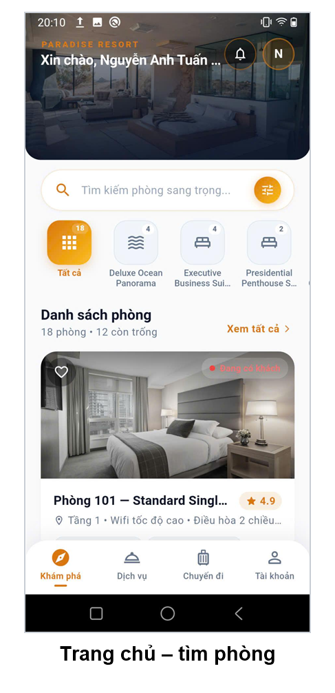

*Hình 4.5: Trang chủ và danh sách phòng của khách hàng*

#### 6. Chi tiết phòng
- **Tập tin:** `lib/features/customer/screens/room_detail_screen.dart`
- **API:** `GET /rooms/{id}`
- **Mô tả:** ảnh lớn, hạng phòng, cảnh báo nếu phòng đang có khách, diện tích, loại giường, hướng nhìn, sức chứa, điểm nổi bật, tiện nghi theo nhóm, đánh giá của khách; thanh giá và nút “Chọn ngày đặt trước” cố định ở cuối màn hình.

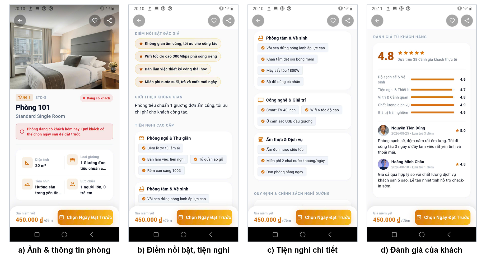

*Hình 4.6: Màn hình chi tiết phòng*

#### 7. Xác nhận đặt phòng
- **Tập tin:** `lib/features/customer/widgets/create_booking_modal.dart`
- **API:** `GET /rooms/available` (kiểm tra khi mở), `POST /bookings`
- **Mô tả:** chọn ngày nhận/trả, số khách, yêu cầu đặc biệt; hiển thị số đêm, tổng tiền và quy định đặt cọc trước khi gửi.

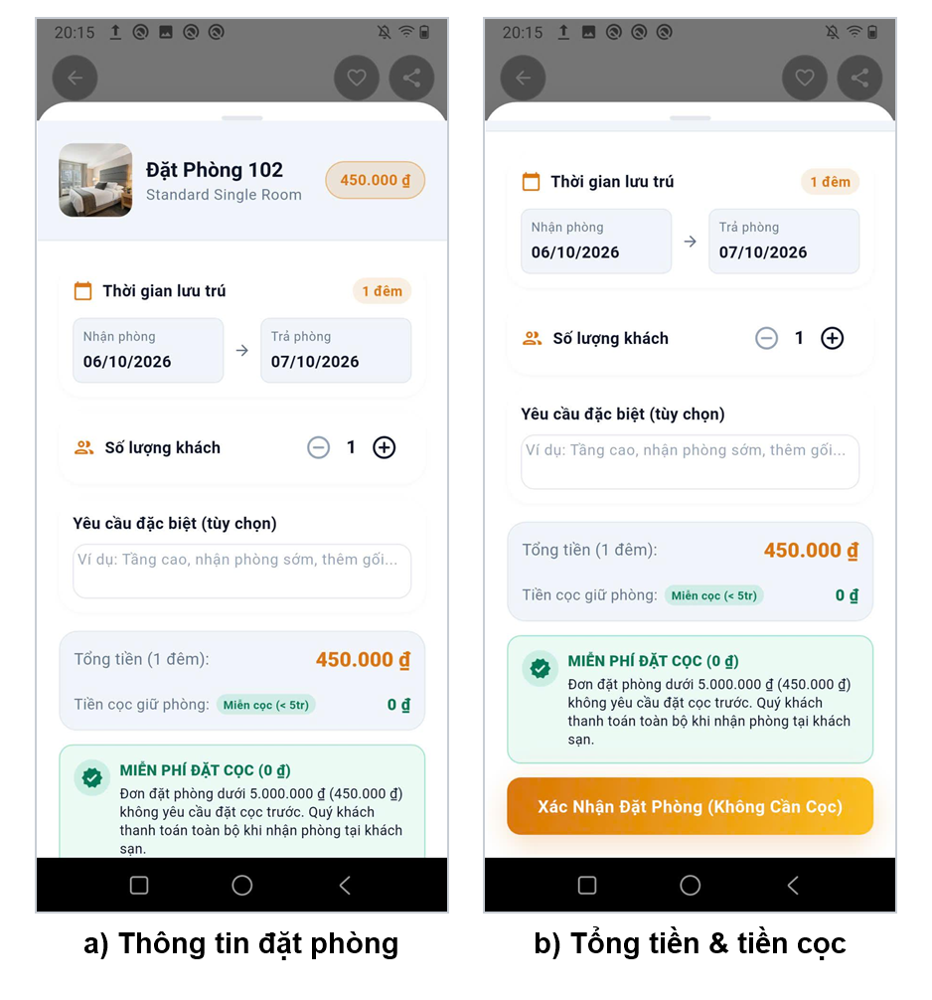

*Hình 4.7: Màn hình xác nhận đặt phòng*

#### 8. Đơn đặt phòng và hóa đơn của tôi
- **Tập tin:** `lib/features/customer/screens/my_bookings_screen.dart`, `my_invoices_screen.dart`
- **API:** `GET /bookings`, `PATCH /bookings/{id}/cancel`, `GET /invoices/my`, `POST /invoices/{id}/payment-requests`
- **Mô tả:** lọc đơn theo trạng thái (tất cả, chờ duyệt, đã xác nhận…), mã đơn, ngày lưu trú, tổng tiền, nút hủy; hóa đơn hiển thị số phải thanh toán, đã trả, còn thiếu và nút thanh toán.

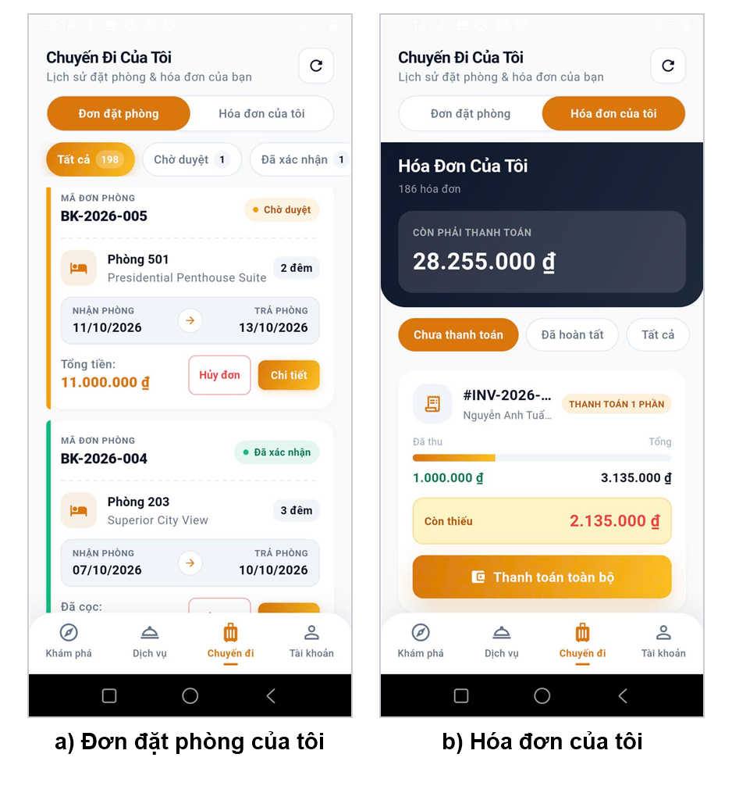

*Hình 4.8: Màn hình đơn đặt phòng và hóa đơn của khách hàng*

#### 9. Gọi dịch vụ phòng
- **Tập tin:** `lib/features/customer/screens/service_order_screen.dart`
- **API:** `GET /services`, `POST /bookings/{id}/service-requests`

> 📸 **[KHUNG CHÈN ẢNH]** Chụp danh mục dịch vụ khi khách đang lưu trú.

*Hình 4.9: Màn hình gọi dịch vụ phòng*

### 4.2.3. Phân hệ lễ tân – thu ngân

#### 10. Sơ đồ phòng (Room Matrix)
- **Tập tin:** `lib/features/receptionist/screens/room_matrix_screen.dart`
- **API:** `GET /rooms`, SSE `GET /rooms/stream`, `PATCH /rooms/{id}/status`
- **Mô tả:** thống kê nhanh số phòng trống / đang ở / chờ dọn / khách đến; phòng chia theo tầng, mỗi ô có số phòng, màu và nhãn trạng thái; ô phòng đổi màu ngay khi máy khác check-in/check-out; nút “Nhận phòng tại quầy” cho khách vãng lai.

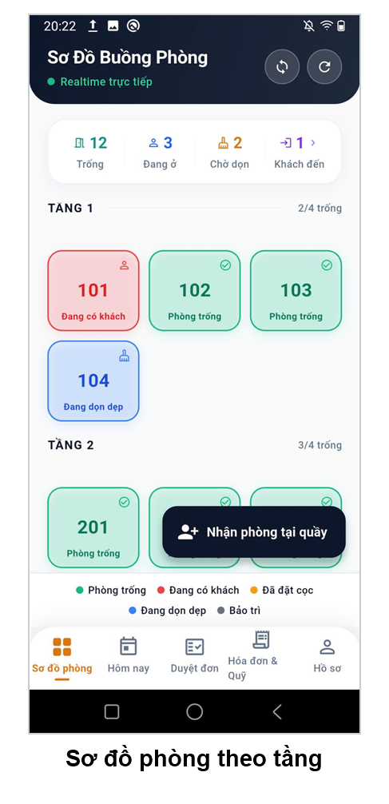

*Hình 4.10: Màn hình sơ đồ phòng của lễ tân*

#### 11. Lượt khách hôm nay: nhận phòng và trả phòng
- **Tập tin:** `lib/features/receptionist/screens/front_desk_today_screen.dart`, `lib/features/admin/screens/today_check_ins_screen.dart`, `today_check_outs_screen.dart`
- **API:** `GET /bookings?status=…&checkInFrom=&checkInTo=`, `POST /bookings/{id}/check-in`, `GET /bookings/{id}/checkout-preview`, `POST /bookings/{id}/check-out`

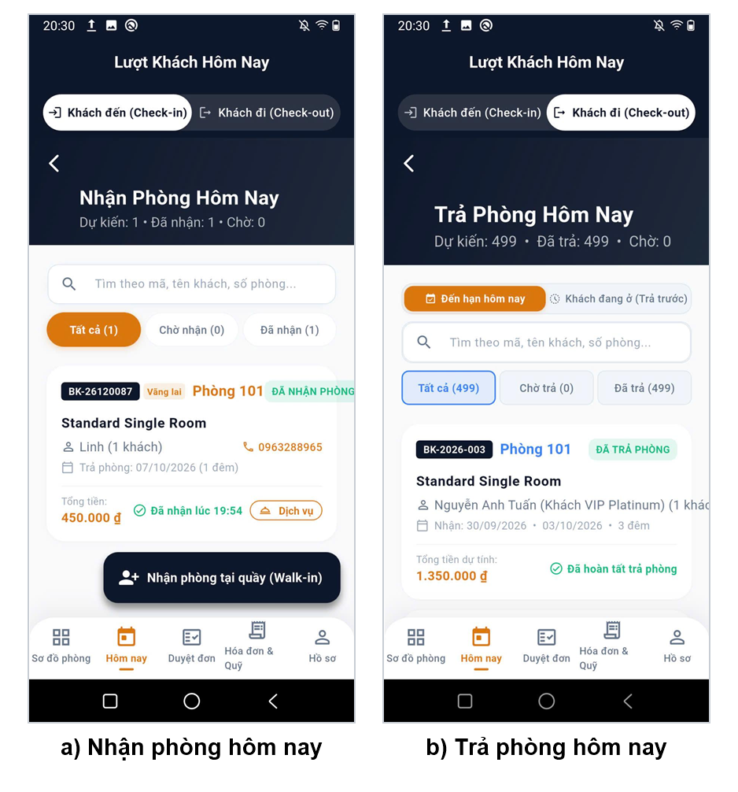

*Hình 4.11: Màn hình nhận phòng và trả phòng hôm nay*

#### 12. Đổi phòng
- **Tập tin:** `lib/features/receptionist/widgets/change_room_sheet.dart`
- **API:** `POST /bookings/{id}/change-room`
- **Mô tả:** hiển thị phòng hiện tại, chọn phòng trống mới, nhập lý do, tùy chọn giữ nguyên đơn giá cũ.

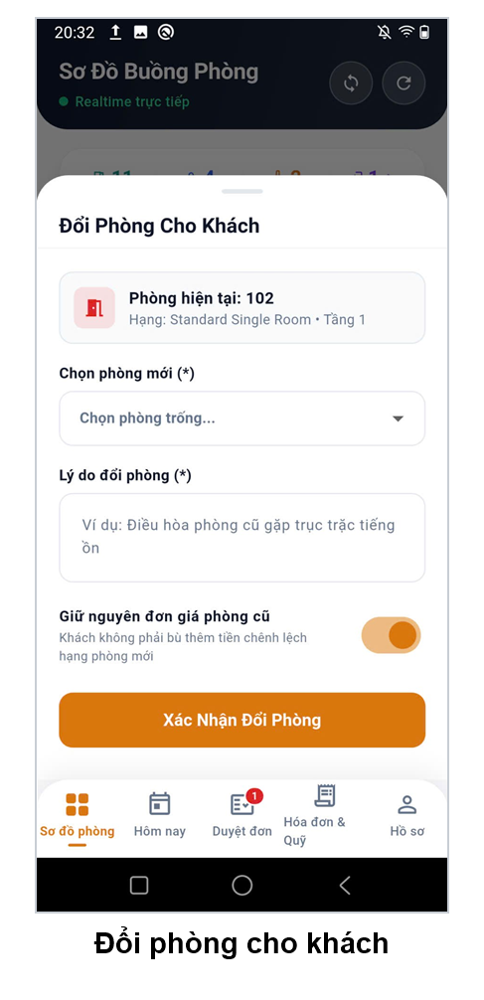

*Hình 4.12: Màn hình đổi phòng cho khách*

#### 13. Hóa đơn và thu tiền
- **Tập tin:** `lib/features/cashier/screens/cashier_invoices_screen.dart`, `widgets/invoice_detail_sheet.dart`, `widgets/payment_sheet.dart`
- **API:** `GET /invoices/{id}`, `POST /invoices/{id}/pay`, `POST /invoices/{id}/refund`
- **Mô tả:** bảng kê tiền phòng, dịch vụ, thuế, tổng, đã thanh toán, còn thiếu; sổ các lần thu; ghi nhận thu tiền với mức thu nhanh (toàn bộ / 50%) và phương thức tiền mặt, chuyển khoản VietQR, thẻ POS.

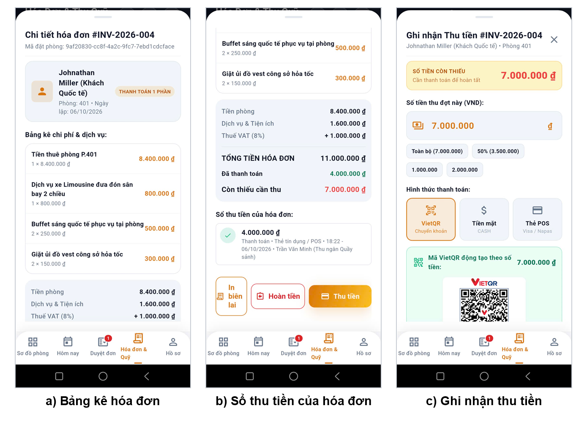

*Hình 4.13: Màn hình chi tiết hóa đơn và ghi nhận thu tiền*

#### 14. Duyệt đơn và yêu cầu thanh toán
- **Tập tin:** `lib/features/receptionist/screens/booking_approval_screen.dart`, `payment_requests_screen.dart`
- **API:** `PATCH /bookings/{id}/approve | reject`, `GET /invoices/payment-requests`, `POST /invoices/payments/{id}/confirm | reject`

> 📸 **[KHUNG CHÈN ẢNH]** Chụp danh sách đơn chờ duyệt và danh sách yêu cầu chuyển khoản chờ đối soát.

*Hình 4.14: Màn hình duyệt đơn và đối soát yêu cầu thanh toán*

#### 15. Mở ca và chốt ca trực
- **Tập tin:** `lib/features/receptionist/widgets/open_shift_sheet.dart`, `lib/features/receptionist/screens/shift_close_screen.dart`
- **API:** `POST /shifts/open`, `GET /shifts/current`, `POST /shifts/close`
- **Mô tả:** chọn ca (sáng/chiều/đêm/linh hoạt), quầy trực, tiền mặt nhận bàn giao; khi chốt ca hiển thị tiền đầu ca, tiền mặt thu trong ca, tiền két lý thuyết, ô nhập tiền thực đếm, thông báo khớp hoặc lệch và nhân viên nhận bàn giao.

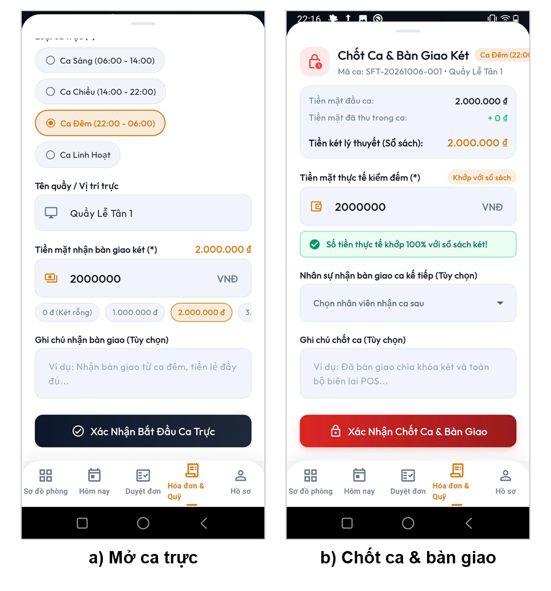

*Hình 4.15: Màn hình mở ca và chốt ca trực*

### 4.2.4. Phân hệ quản trị viên

#### 16. Dashboard quản trị
- **Tập tin:** `lib/features/admin/screens/admin_dashboard_screen.dart`
- **API:** `GET /analytics/dashboard`, `GET /analytics/revenue/daily?range=7`, `GET /shifts/active`
- **Mô tả:** doanh thu hôm nay, tỷ lệ lấp đầy, lượt nhận/trả phòng và đơn chờ duyệt; tình trạng ca trực tại quầy; biểu đồ doanh thu 7 ngày; cơ cấu buồng phòng theo trạng thái.

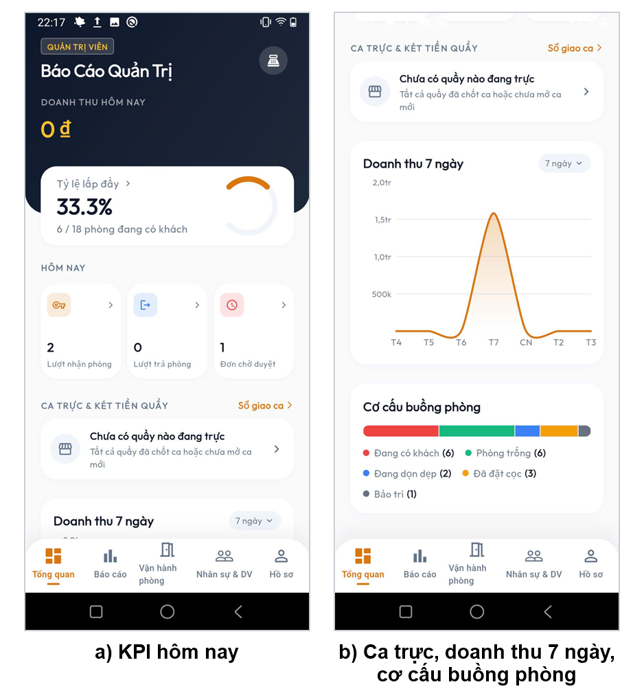

*Hình 4.16: Màn hình dashboard quản trị*

#### 17. Báo cáo, danh mục, tài khoản và lịch sử ca
- **Tập tin:** `lib/features/admin/screens/reports_screen.dart`, `occupancy_detail_screen.dart`, `room_type_management_screen.dart`, `service_catalog_screen.dart`, `user_management_screen.dart`, `admin_shift_management_screen.dart`, `shift_detail_screen.dart`
- **API:** `GET /analytics/revenue`, `GET /analytics/occupancy-by-type`, CRUD `/room-types`, `/services`, `/users`, `GET /shifts`, `POST /shifts/{id}/close`

> 📸 **[KHUNG CHÈN ẢNH]** Chụp màn hình báo cáo doanh thu năm, quản lý tài khoản và lịch sử ca trực.

*Hình 4.17: Các màn hình báo cáo và quản trị*

---

\newpage

# CHƯƠNG 5: KIỂM THỬ VÀ ĐÁNH GIÁ KẾT QUẢ

## 5.1. Kế hoạch và phương pháp kiểm thử

Hoạt động kiểm thử được tổ chức theo cấu trúc tài liệu của chuẩn IEEE 829 (kế hoạch – thiết kế ca kiểm thử – báo cáo kết quả) và gồm năm hạng mục:

1. **Kiểm thử API hộp đen trên máy chủ triển khai:** 39 ca kiểm thử chia 5 nhóm (xác thực, phân quyền, danh mục, đặt phòng, thống kê – đăng xuất). Các ca được thiết kế bằng phân vùng tương đương, giá trị biên, bảng quyết định cho phân quyền và kiểm thử chuyển trạng thái; được đóng gói thành Postman Collection và chạy tự động bằng script `tool/docx/run_api_tests.js`.
2. **Kiểm thử đặt phòng đồng thời:** gửi cùng lúc nhiều yêu cầu đặt một phòng trong cùng khoảng ngày để kiểm chứng cơ chế chống đặt trùng.
3. **Đo hiệu năng:** gửi liên tiếp nhiều request với nhiều luồng song song tới các API đọc dữ liệu phổ biến (`tool/docx/run_load_test.js`).
4. **Kiểm thử tự động phía ứng dụng:** bộ test Flutter (49 file) kiểm tra ánh xạ hợp đồng API, phân trang, xử lý lỗi, phân quyền theo vai trò, phiên một thiết bị, các luồng check-in/check-out và ca trực.
5. **Kiểm tra tĩnh:** biên dịch TypeScript toàn bộ backend (`tsc --noEmit`).

Toàn bộ kiểm thử API chạy trên máy chủ thật `https://hotel-management-plsp.onrender.com/api/v1` (Render, gói miễn phí, region Singapore). Để không làm bẩn dữ liệu vận hành, các bộ kiểm thử đặt phòng ở ngày xa trong tương lai, duyệt đơn với tiền cọc 0 đ và tự dọn dữ liệu sau khi chạy (hủy đơn thử, xóa dịch vụ thử, vô hiệu hóa tài khoản thử).

## 5.2. Kết quả kiểm thử API

Kết quả chạy lúc 15:31 ngày 20/10/2026: **38/39 ca đạt**, thời gian phản hồi trung bình 322 ms/request.

*Bảng 5.1: Tổng hợp kết quả kiểm thử API theo nhóm*

| Nhóm | Số ca | Đạt | Không đạt |
| :--- | :---: | :---: | :---: |
| 1. Xác thực & tài khoản | 11 | 11 | 0 |
| 2. Phân quyền (RBAC) | 4 | 4 | 0 |
| 3. Danh mục: loại phòng, phòng, dịch vụ | 9 | 9 | 0 |
| 4. Đặt phòng & quản lý trạng thái | 9 | 9 | 0 |
| 5. Thống kê, đăng xuất & khóa tài khoản | 6 | 5 | 1 |
| **Tổng cộng** | **39** | **38** | **1** |

*Bảng 5.2: Kịch bản và kết quả kiểm thử API*

| Mã | Ca kiểm thử | Request | Mong đợi | Thực tế | Kết quả |
| :---: | :--- | :--- | :--- | :---: | :---: |
| TC01 | Đăng ký tài khoản khách hàng mới (cố tình gửi role = ADMIN) | `POST /auth/register` | 201 – Tạo tài khoản; server ép role = CUSTOMER; trả về accessToken, refreshToken | 201 · 811 ms | Đạt |
| TC02 | Đăng ký trùng email | `POST /auth/register` | 409 – message = "Email này đã được đăng ký trong hệ thống" | 409 · 265 ms | Đạt |
| TC03 | Đăng ký thiếu dữ liệu / sai định dạng | `POST /auth/register` | 400 – ValidationPipe trả mảng errors: email sai định dạng, mật khẩu < 6 ký tự, thiếu họ tên | 400 · 268 ms | Đạt |
| TC04 | Đăng nhập Admin đúng thông tin | `POST /auth/login` | 201 – Trả về user (role = ADMIN), accessToken và refreshToken (JWT) | 201 · 972 ms | Đạt |
| TC05 | Đăng nhập Lễ tân | `POST /auth/login` | 201 – Trả về user (role = RECEPTIONIST) và cặp token | 201 · 779 ms | Đạt |
| TC06 | Đăng nhập sai mật khẩu | `POST /auth/login` | 401 – message = "Email hoặc mật khẩu không chính xác" | 401 · 519 ms | Đạt |
| TC07 | Gọi API cần đăng nhập nhưng không gửi token | `GET /auth/me` | 401 – message = "Bạn chưa đăng nhập hoặc phiên làm việc đã hết hạn" | 401 · 263 ms | Đạt |
| TC08 | Gửi token giả mạo | `GET /auth/me` | 401 – JwtStrategy từ chối chữ ký không hợp lệ | 401 · 256 ms | Đạt |
| TC09 | Xem thông tin cá nhân | `GET /auth/me` | 200 – Trả về hồ sơ của chính tài khoản đang đăng nhập, không có trường password | 200 · 273 ms | Đạt |
| TC10 | Làm mới token (refresh token rotation) | `POST /auth/refresh-token` | 201 – Cấp cặp accessToken + refreshToken mới | 201 · 260 ms | Đạt |
| TC11 | Cập nhật thông tin cá nhân | `PATCH /users/me` | 200 – fullName, phone được cập nhật | 200 · 279 ms | Đạt |
| TC12 | Khách hàng xem danh sách người dùng | `GET /users` | 403 – RolesGuard: "Quyền truy cập bị từ chối: Yêu cầu vai trò [ADMIN, RECEPTIONIST]" | 403 · 272 ms | Đạt |
| TC13 | Lễ tân xem báo cáo doanh thu năm (chỉ Admin) | `GET /analytics/revenue` | 403 – RolesGuard chặn vì endpoint chỉ dành cho ADMIN | 403 · 236 ms | Đạt |
| TC14 | Khách hàng tạo loại phòng | `POST /room-types` | 403 – Chỉ ADMIN được tạo loại phòng | 403 · 277 ms | Đạt |
| TC15 | Admin xem danh sách người dùng có tìm kiếm + phân trang | `GET /users?search=hotel&page=1&limit=5` | 200 – data là mảng ≤ 5 phần tử, meta có total, page = 1, limit = 5, totalPages | 200 · 262 ms | Đạt |
| TC16 | Xem loại phòng (công khai) | `GET /room-types` | 200 – Không cần token; trả danh sách loại phòng kèm giá, tiện nghi | 200 · 270 ms | Đạt |
| TC17 | Danh sách phòng có phân trang + lọc trạng thái | `GET /rooms?status=AVAILABLE&page=1&limit=5` | 200 – Cấu trúc { data: [...], meta: { total, page, limit, totalPages } } | 200 · 277 ms | Đạt |
| TC18 | Lọc phòng với trạng thái không hợp lệ | `GET /rooms?status=ABC` | 400 – message = "status không hợp lệ" | 400 · 277 ms | Đạt |
| TC19 | Tìm phòng trống theo khoảng ngày | `GET /rooms/available?checkInDate={{checkIn}}&checkOutDate={{checkOut}}&guestCount=1` | 200 – Trả danh sách phòng không trùng lịch trong khoảng ngày; lưu roomId đầu tiên để đặt phòng | 200 · 272 ms | Đạt |
| TC20 | Admin thêm dịch vụ mới | `POST /services` | 201 – Tạo bản ghi dịch vụ, trả về id | 201 · 255 ms | Đạt |
| TC21 | Admin thêm dịch vụ với đơn giá âm | `POST /services` | 400 – message chứa "Đơn giá phải lớn hơn 0" | 400 · 265 ms | Đạt |
| TC22 | Admin cập nhật dịch vụ | `PATCH /services/{id}` | 200 – unitPrice = 60000, isAvailable = false | 200 · 255 ms | Đạt |
| TC23 | Admin xóa dịch vụ | `DELETE /services/{id}` | 200 – Xóa thành công bản ghi dịch vụ thử | 200 · 264 ms | Đạt |
| TC24 | Xem dịch vụ vừa xóa | `GET /services/{id}` | 404 – Không còn tìm thấy dịch vụ | 404 · 254 ms | Đạt |
| TC25 | Đặt phòng với ngày nhận ≥ ngày trả | `POST /bookings` | 400 – message = "Ngày nhận phòng phải trước ngày trả phòng" | 400 · 249 ms | Đạt |
| TC26 | Khách hàng đặt phòng hợp lệ | `POST /bookings` | 201 – Đơn ở trạng thái PENDING, có bookingCode BK-xxxx, totalAmount = số đêm × giá loại phòng | 201 · 281 ms | Đạt |
| TC27 | Đặt trùng lịch cùng phòng | `POST /bookings` | 409 – "Phòng này đã có khách đặt hoặc đang ở trong khoảng thời gian được chọn" | 409 · 248 ms | Đạt |
| TC28 | Check-in đơn đang chờ duyệt | `POST /bookings/{id}/check-in` | 400 – Từ chối vì đơn PENDING chưa được phê duyệt | 400 · 260 ms | Đạt |
| TC29 | Lễ tân phê duyệt đơn | `PATCH /bookings/{id}/approve` | 200 – Đơn chuyển PENDING → CONFIRMED, ghi người duyệt và thời điểm duyệt | 200 · 306 ms | Đạt |
| TC30 | Khách hàng xem danh sách đơn của mình | `GET /bookings?page=1&limit=10` | 200 – Chỉ trả về đơn của chính khách hàng (server ép customerId = user hiện tại) | 200 · 252 ms | Đạt |
| TC31 | Khách tự hủy đơn đã được xác nhận | `PATCH /bookings/{id}/cancel` | 403 – Khách chỉ được tự hủy đơn PENDING; đơn CONFIRMED phải liên hệ lễ tân | 403 · 259 ms | Đạt |
| TC32 | Lễ tân hủy đơn có lý do | `PATCH /bookings/{id}/cancel` | 200 – Đơn chuyển CANCELLED, lưu cancellationReason, cancelledAt, cancelledBy | 200 · 457 ms | Đạt |
| TC33 | Xem đơn đặt phòng không tồn tại | `GET /bookings/00000000-0000-0000-0000-000000000000` | 404 – NotFoundException với thông điệp tiếng Việt | 404 · 242 ms | Đạt |
| TC34 | Dashboard thống kê | `GET /analytics/dashboard` | 200 – Trả các KPI: công suất phòng, doanh thu, số booking, phòng trống… | 200 · 285 ms | Đạt |
| TC35 | Danh sách hóa đơn có phân trang | `GET /invoices?page=1&limit=5` | 200 – Cấu trúc { data, meta }, tối đa 5 hóa đơn | 200 · 276 ms | Đạt |
| TC36 | Đăng xuất | `POST /auth/logout` | 201 – "Đăng xuất thành công"; refresh token bị thu hồi, activeSessionId bị xóa | 201 · 266 ms | Đạt |
| TC37 | Dùng lại token sau khi đăng xuất | `GET /auth/me` | 401 – "Phiên làm việc đã kết thúc do đăng xuất. Vui lòng đăng nhập lại" | 200 · 273 ms | **Không đạt** |
| TC38 | Admin vô hiệu hóa tài khoản kiểm thử | `DELETE /users/{id}` | 200 – isActive = false (xóa mềm) | 200 · 263 ms | Đạt |
| TC39 | Đăng nhập bằng tài khoản đã bị khóa | `POST /auth/login` | 401 – message = "Tài khoản của bạn đã bị khóa" | 401 · 271 ms | Đạt |

Ở lần chạy đầu, ca phê duyệt đơn báo sai do kịch bản kiểm thử đọc nhầm vị trí trường trạng thái trong phản hồi (API trả `data.booking.status`); kịch bản đã được sửa và chạy lại toàn bộ. Ca không đạt còn lại (TC37) là lỗi thật của hệ thống:

*Bảng 5.3: Báo cáo lỗi BUG-01*

| Mục | Nội dung |
| :--- | :--- |
| Ca kiểm thử | TC37 – Dùng lại access token sau khi đăng xuất |
| Bước tái hiện | Khách hàng đăng nhập → gọi `POST /auth/logout` (201) → gọi lại `GET /auth/me` bằng chính token cũ |
| Mong đợi | 401 – “Phiên làm việc đã kết thúc do đăng xuất. Vui lòng đăng nhập lại” |
| Thực tế | 200 – vẫn trả hồ sơ người dùng; token cũ còn dùng được đến khi hết hạn (tối đa 1 ngày) |
| Nguyên nhân | `AuthService.logout()` chỉ ghi token vào blacklist khi `redisService.isReady` (có Redis thật). Bản triển khai trên Render không có Redis nên `RedisService` chạy chế độ bộ nhớ dự phòng, bước blacklist bị bỏ qua. `JwtStrategy` chỉ so khớp `sid` khi `activeSessionId` khác null, mà đăng xuất lại xóa `activeSessionId`. |
| Mức độ | Trung bình – ảnh hưởng yêu cầu chống truy cập trái phép khi token bị lộ sau đăng xuất |
| Đề xuất sửa | Bỏ điều kiện `isReady` khi ghi blacklist (`RedisService.set()` đã tự lưu vào bộ nhớ khi chưa có Redis); trong `JwtStrategy` từ chối token có `sid` khi `activeSessionId` đã bị xóa; bổ sung dịch vụ Redis cho môi trường Render |

## 5.3. Kiểm thử đặt phòng đồng thời

Kịch bản: một tài khoản khách hàng gửi **đồng thời 10 yêu cầu** `POST /bookings` cho cùng phòng 101, cùng khoảng ngày 2027-12-28 → 2027-12-30 (chạy lúc 15:45 ngày 20/10/2026). Sau đó lễ tân truy vấn lại danh sách đơn của phòng trong khoảng ngày này để đối chiếu dữ liệu thực trong CSDL.

*Bảng 5.4: Kết quả kiểm thử đặt phòng đồng thời*

| Chỉ số | Kết quả |
| :--- | :--- |
| Số yêu cầu gửi đồng thời | 10 |
| Phản hồi 201 Created | 1 |
| Phản hồi 409 Conflict | 9 |
| Số đơn còn hiệu lực trong CSDL | 1 |
| Thông điệp từ chối | Phòng này đang được khách khác giữ chỗ để thanh toán, vui lòng thử lại sau giây lát! |

Kết quả cho thấy chỉ đúng **1 đơn** được tạo; các yêu cầu còn lại bị khóa phân tán chặn ngay từ đầu với mã 409, không có đơn trùng lịch nào được ghi vào CSDL. Đơn thử và tài khoản thử được dọn sau khi kiểm thử.

## 5.4. Đo hiệu năng

Kịch bản: mỗi API được gọi 200 lần với 10 luồng song song từ máy kiểm thử tại Việt Nam tới máy chủ Render (region Singapore), chạy lúc 15:45 ngày 20/10/2026. Thời gian đo là thời gian phản hồi phía máy khách, đã bao gồm độ trễ mạng.

*Bảng 5.5: Kết quả đo hiệu năng API*

| API | Số request | Lỗi | Thông lượng (req/s) | Trung bình (ms) | P50 (ms) | P95 (ms) | Lớn nhất (ms) |
| :--- | :---: | :---: | :---: | :---: | :---: | :---: | :---: |
| Danh sách loại phòng (`GET /room-types`) | 200 | 0 | 28,3 | 349 | 274 | 905 | 1.106 |
| Danh sách phòng (phân trang) (`GET /rooms`) | 200 | 0 | 9,5 | 1.033 | 921 | 1.999 | 2.310 |
| Tìm phòng trống theo ngày (`GET /rooms/available`) | 200 | 0 | 9,7 | 1.027 | 907 | 1.800 | 2.201 |
| Danh mục dịch vụ (`GET /services`) | 200 | 0 | 27,7 | 357 | 306 | 597 | 807 |

Nhận xét:

- Không có request nào lỗi trong 800 request.
- Các API danh mục nhỏ (loại phòng, dịch vụ) phản hồi trung bình khoảng 0,35 giây; các API danh sách phòng và tìm phòng trống – phải kết hợp phòng, loại phòng và lịch đặt – trung bình khoảng 1 giây, thông lượng khoảng 10 request/giây.
- Số liệu phản ánh môi trường gói miễn phí của Render (tài nguyên CPU hạn chế, một instance, không có Redis nên bộ đệm chạy trong bộ nhớ tiến trình) cộng độ trễ mạng quốc tế; đây là giới hạn của môi trường thử nghiệm, chưa phải năng lực tối đa của kiến trúc. Hướng cải thiện được nêu ở mục 7.3.

## 5.5. Kiểm thử tự động phía ứng dụng và kiểm tra tĩnh

*Bảng 5.6: Kết quả kiểm thử tự động khác (chạy ngày 20/10/2026)*

| Hạng mục | Lệnh | Kết quả |
| :--- | :--- | :--- |
| Biên dịch backend (type-check toàn bộ `src`) | `npx tsc --noEmit` | 0 lỗi |
| Test tự động ứng dụng Flutter (49 file test) | `flutter test` | 275 / 275 test đạt (khoảng 12 giây) |
| Sinh script DDL từ Prisma schema | `prisma migrate diff --from-empty` | 10 bảng, 384 dòng SQL |

Bộ test ứng dụng bao gồm: kiểm thử hợp đồng API (`api_contract_update_test`, `model_alignment_test`), phân trang (`pagination_system_test`, `booking_pagination_cache_test`), xử lý lỗi API (`api_error_test`, `global_error_handling_test`), phân quyền theo vai trò (`role_access_test`), phiên một thiết bị (`single_device_session_test`), check-in/check-out (`walk_in_check_in_test`, `early_checkout_test`), chốt ca (`work_shift_test`, `receptionist_shift_flow_test`) và cập nhật realtime qua SSE (`room_realtime_test`, `sse_client_test`).

## 5.6. Đánh giá an toàn và bảo mật

**Các biện pháp đã có và được kiểm chứng:**

- Mật khẩu băm bcrypt (salt 10); API trả hồ sơ người dùng không bao giờ chứa trường `password` (TC09).
- Phân quyền theo vai trò ở từng API: khách gọi API của nhân viên, lễ tân gọi API chỉ dành cho quản trị đều bị chặn 403 (TC12–TC14).
- Token giả mạo hoặc thiếu token bị chặn 401 (TC07, TC08); tài khoản bị vô hiệu hóa không đăng nhập được (TC39).
- Dữ liệu vào được kiểm tra bằng DTO, trường không khai báo bị từ chối; đăng ký luôn gán vai trò `CUSTOMER` dù client gửi `role = ADMIN` (TC01, TC03).
- Truy vấn CSDL qua Prisma được tham số hóa, giá trị đầu vào không ghép chuỗi vào câu SQL.

**Các điểm yếu phát hiện khi rà soát mã nguồn:**

- **BUG-01:** token chưa bị thu hồi sau đăng xuất khi chạy không có Redis (mục 5.2).
- Mã OTP khôi phục mật khẩu đang là giá trị cố định cấu hình qua `DEFAULT_OTP` (mặc định `123456`) phục vụ môi trường demo; khi triển khai thật phải sinh mã ngẫu nhiên.
- Cơ chế tự tạo/khôi phục các tài khoản mặc định khi đăng nhập và giá trị `JWT_SECRET` dự phòng trong mã nguồn chỉ phù hợp môi trường demo.
- `POST /notifications/send` và `/notifications/broadcast` chưa giới hạn vai trò bằng `@Roles`.

---

\newpage

# CHƯƠNG 6: QUẢN LÝ DỰ ÁN VÀ TRIỂN KHAI

## 6.1. Tiến độ phát triển thực tế

Tiến độ dưới đây được tổng hợp từ lịch sử Git của hai kho mã nguồn (backend `Hotel-Management`: 51 commit; ứng dụng `hotel_app`: 15 commit).

*Bảng 6.1: Tiến độ phát triển theo lịch sử commit*

| Vòng lặp | Thời gian (2026) | Backend | Ứng dụng di động |
| :---: | :---: | :--- | :--- |
| 1 | 03/09 – 04/09 | Khởi tạo dự án, Prisma schema, dữ liệu mẫu; module xác thực, tải ảnh, JwtAuthGuard + RolesGuard; trạng thái phòng chờ duyệt; đặt phòng với khóa Redis và duyệt đơn; Elasticsearch; chuẩn hóa giờ nhận/trả phòng | Kiến trúc lõi, điều hướng theo vai trò, thư viện component; màn hình đặt phòng, đơn của tôi với lọc trạng thái và hủy đơn |
| 2 | 05/09 | Gộp vai trò thu ngân vào lễ tân; interceptor chuẩn hóa phản hồi; hóa đơn, sổ thu tiền, yêu cầu thanh toán | Hệ thống hóa đơn cho thu ngân, quản trị và khách hàng |
| 3 | 07/09 | Module ca trực; quản lý tài khoản đầy đủ, đặt lại mật khẩu, SSE danh sách tài khoản | Tìm phòng, dashboard lễ tân/quản trị, quản lý tài khoản, tầng repository |
| 4 | 19/09 – 21/09 | Thông báo FCM; thống kê; đồng bộ trạng thái phòng; cron nhắc lịch nhận phòng; xuất báo cáo doanh thu CSV | Hoàn thiện các màn hình, luồng từ chối thanh toán, đồng bộ trạng thái phòng |
| 5 | 20/10 | — | Viết tài liệu, sơ đồ UML, kiểm thử API trên máy chủ thật, đo hiệu năng |

## 6.2. Phân rã công việc (WBS)

Công việc được phân rã theo module, mỗi module ánh xạ tới một nhóm yêu cầu chức năng:

*Bảng 6.2: Phân rã công việc theo module*

| Nhóm công việc | Backend | Ứng dụng | Yêu cầu |
| :--- | :--- | :--- | :--- |
| Xác thực, tài khoản | `auth`, `users` | `features/auth`, `features/profile`, `admin/user_management` | FR-01 – FR-03, FR-20, FR-21 |
| Danh mục phòng, sơ đồ phòng | `room-types`, `rooms`, `elasticsearch` | `customer/home`, `room_search`, `room_detail`, `receptionist/room_matrix` | FR-04 – FR-07, FR-27 |
| Đặt phòng, lưu trú | `bookings` | `create_booking_modal`, `my_bookings`, `front_desk_today`, `change_room_sheet` | FR-08 – FR-12, FR-24 |
| Dịch vụ | `services` | `service_order_screen`, `service_catalog_screen` | FR-13, FR-14 |
| Tài chính, ca trực | `invoices`, `shifts` | `features/cashier`, `shift_close_screen`, `payment_requests_screen` | FR-15, FR-16, FR-25, FR-26 |
| Báo cáo, thông báo | `analytics`, `notifications`, `mail` | `admin_dashboard`, `reports_screen`, `features/notifications` | FR-17 – FR-19, FR-22, FR-23 |
| Hạ tầng, triển khai | `prisma`, `redis`, `upload`, Docker, Render | `core/network`, `di`, `core/router` | Yêu cầu phi chức năng |

## 6.3. Phân tích và kiểm soát rủi ro kỹ thuật

*Bảng 6.3: Ma trận rủi ro kỹ thuật*

| STT | Rủi ro | Xác suất | Tác động | Giải pháp |
| :---: | :--- | :---: | :---: | :--- |
| 1 | Đặt trùng phòng khi nhiều người đặt cùng lúc | Vừa | Rất lớn | Khóa phân tán theo phòng + kiểm tra giao lịch; đã kiểm chứng bằng kiểm thử đồng thời (mục 5.3) |
| 2 | Sai lệch tiền mặt khi bàn giao ca | Lớn | Lớn | Khai báo tiền đầu ca, tự tính tiền sổ sách, bắt buộc giải trình chênh lệch |
| 3 | Khách báo chuyển khoản nhưng tiền chưa về | Vừa | Lớn | Yêu cầu thanh toán ở trạng thái `PENDING`, chỉ tính vào hóa đơn sau khi thu ngân xác nhận |
| 4 | Máy chủ gói miễn phí ngủ khi không có truy cập, phản hồi chậm ở lần gọi đầu | Lớn | Vừa | Gọi khởi động trước khi demo; nâng cấp gói hoặc dùng dịch vụ giữ máy chủ hoạt động |
| 5 | Môi trường triển khai thiếu Redis | Đã xảy ra | Vừa | Có chế độ bộ nhớ dự phòng; cần bổ sung Redis để blacklist token và bộ đệm dùng chung (BUG-01) |
| 6 | Cấu trúc CSDL trên máy chủ lệch với schema | Vừa | Lớn | `prisma db push` khi khởi động và cơ chế tự đồng bộ cấu trúc trong `PrismaService`; lỗi thiếu bảng/cột được báo rõ |

## 6.4. Đóng gói Docker và triển khai

Môi trường phát triển dùng Docker Compose để khởi chạy toàn bộ hạ tầng (rút gọn từ `docker-compose.yml` của dự án; mật khẩu nên đặt qua biến môi trường):

```yaml
services:
  postgres:
    image: postgres:16-alpine
    container_name: hotel_postgres
    environment:
      POSTGRES_USER: postgres
      POSTGRES_PASSWORD: ${POSTGRES_PASSWORD}
      POSTGRES_DB: hotel_db
    ports: ["5432:5432"]
    healthcheck:
      test: ["CMD-SHELL", "pg_isready -U postgres -d hotel_db"]
  redis:
    image: redis:7-alpine
    container_name: hotel_redis
    command: ["redis-server", "--appendonly", "yes"]
    ports: ["6379:6379"]
  elasticsearch:
    image: docker.elastic.co/elasticsearch/elasticsearch:8.11.0
    environment: ["discovery.type=single-node", "xpack.security.enabled=false"]
    ports: ["9200:9200"]
  hotelmanagementbackend:
    build: { context: ., dockerfile: ./Dockerfile }
    container_name: hotel_backend
    ports: ["3000:3000"]
    environment: { PORT: 3000, NODE_ENV: production }
```

Môi trường production chạy trên **Render** theo `render.yaml`: dịch vụ web build từ Dockerfile (`node:20-alpine`), cơ sở dữ liệu PostgreSQL do Render cấp và tự nạp `DATABASE_URL`, `JWT_SECRET` được sinh ngẫu nhiên, múi giờ báo cáo `Asia/Ho_Chi_Minh`. Tài liệu API trực tuyến tại `/api/docs`.

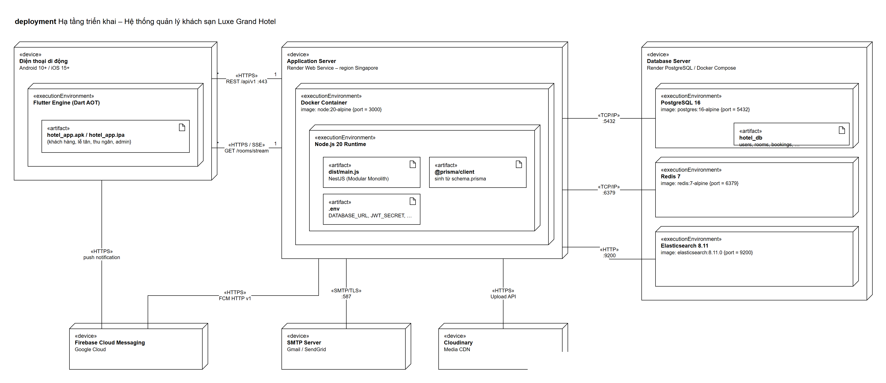

*Hình 6.1: Biểu đồ triển khai hệ thống*

## 6.5. Sao lưu và phục hồi cơ sở dữ liệu

- **Sao lưu:**
  ```bash
  docker exec -t hotel_postgres pg_dump -U postgres hotel_db > backup_hotel_$(date +%Y%m%d_%H%M%S).sql
  ```
- **Phục hồi:**
  ```bash
  cat backup_hotel_20261020.sql | docker exec -i hotel_postgres psql -U postgres -d hotel_db
  ```
- Với cơ sở dữ liệu trên Render, dùng tính năng sao lưu của dịch vụ hoặc `pg_dump` với chuỗi kết nối ngoài (external connection string).

---

\newpage

# CHƯƠNG 7: KẾT LUẬN VÀ HƯỚNG PHÁT TRIỂN

## 7.1. Kết quả đạt được

1. **Về công nghệ:**
   - Xây dựng máy chủ RESTful API bằng NestJS theo kiến trúc module với 11 controller, 95 đường dẫn API, xác thực JWT (refresh token rotation, một thiết bị cho khách hàng) và phân quyền 3 vai trò; tích hợp PostgreSQL/Prisma, Redis, Elasticsearch, FCM, Nodemailer và tác vụ định kỳ.
   - Phát triển ứng dụng Flutter đa nền tảng theo kiến trúc hướng tính năng với BLoC, đồng bộ trạng thái phòng thời gian thực qua SSE, biểu đồ FL Chart.
   - Mô hình hóa hệ thống bằng 8 sơ đồ UML (gói, thành phần, triển khai, phân lớp, lớp, tuần tự, use case, luồng BLoC) và 3 sơ đồ hoạt động/trạng thái nghiệp vụ.
2. **Về nghiệp vụ:**
   - Số hóa vòng đời lưu trú: tìm phòng, đặt phòng, duyệt đơn, sơ đồ phòng theo tầng, check-in và khách vãng lai, đổi phòng, dịch vụ phòng, quyết toán và check-out (kể cả trả phòng trước hạn).
   - Kiểm soát dòng tiền bằng sổ thu tiền nhiều đợt và quản lý ca trực có đối soát tiền mặt, bắt buộc giải trình chênh lệch.
   - Cung cấp dashboard và báo cáo doanh thu, công suất, hiệu suất nhân viên cho quản lý.
3. **Về kiểm thử:** 38/39 ca kiểm thử API đạt trên máy chủ thật; kiểm thử đồng thời xác nhận không có đặt trùng phòng; 275/275 test ứng dụng đạt; kiểm thử phát hiện và phân tích được một lỗi bảo mật thật.

## 7.2. Hạn chế

- **BUG-01:** access token chưa bị thu hồi sau đăng xuất khi máy chủ chạy không có Redis.
- Máy chủ gói miễn phí cho thời gian phản hồi 0,3–1 giây với các API danh sách phòng; chưa đo trên hạ tầng có Redis và cấu hình mạnh hơn.
- Backend chưa có unit test / e2e test tự động (Jest, Supertest); kiểm thử API hiện ở mức hộp đen.
- Tầng truy cập dữ liệu dùng trực tiếp `PrismaService`, chưa tách lớp Repository riêng để dễ viết unit test cho Service.
- OTP khôi phục mật khẩu đang cố định cho môi trường demo; cron nhắc lịch chạy lúc 01:00 thay vì giờ hành chính.
- Ứng dụng hiển thị nút “Hủy đơn” cho cả đơn đã xác nhận trong khi API chỉ cho khách tự hủy đơn chờ duyệt (TC31 trả 403).
- Số tiền lưu kiểu `Float`; nghiệp vụ tài chính nên dùng `Decimal` để tránh sai số làm tròn.
- Chưa tích hợp cổng thanh toán tự động và khóa cửa thông minh.

## 7.3. Hướng phát triển

1. **Sửa các lỗi đã phát hiện:** khắc phục BUG-01, sinh OTP ngẫu nhiên, chỉnh giờ cron, giới hạn quyền API gửi thông báo, đồng bộ quy tắc hủy đơn giữa ứng dụng và API.
2. **Nâng cao chất lượng:** tách tầng Repository, bổ sung unit test và e2e test, đưa bộ kiểm thử API vào CI (GitHub Actions); chuyển số tiền sang kiểu `Decimal`.
3. **Thanh toán tự động:** tích hợp VNPay/VietQR qua webhook để hóa đơn tự chuyển `PAID` khi tiền về tài khoản.
4. **Trải nghiệm khách:** tự check-in bằng mã QR, chìa khóa số (BLE/NFC), trợ lý ảo hỗ trợ khách 24/7.
5. **Vận hành:** ứng dụng cho nhân viên buồng phòng cập nhật trạng thái dọn phòng tại tầng; khi quy mô tăng, tách các module tải lớn thành microservice.

---

\newpage

# TÀI LIỆU THAM KHẢO

1. NestJS Documentation, https://docs.nestjs.com/
2. Flutter Documentation, Google, https://docs.flutter.dev/
3. Prisma ORM Documentation, https://www.prisma.io/docs
4. PostgreSQL Global Development Group, PostgreSQL 16 Documentation, https://www.postgresql.org/docs/
5. Felix Angelov, Bloc State Management Library, https://bloclibrary.dev/
6. Redis Documentation – Distributed Locks with Redis, https://redis.io/docs/
7. Roy T. Fielding (2000), *Architectural Styles and the Design of Network-based Software Architectures*, Doctoral dissertation, University of California, Irvine.
8. IETF (2015), *RFC 7519 – JSON Web Token (JWT)*.
9. Robert C. Martin (2017), *Clean Architecture: A Craftsman's Guide to Software Structure and Design*, Prentice Hall.
10. Martin Fowler (2002), *Patterns of Enterprise Application Architecture*, Addison-Wesley.
11. IEEE Computer Society (1998), *IEEE Std 830-1998 – Recommended Practice for Software Requirements Specifications*.
12. IEEE Computer Society (2008), *IEEE Std 829-2008 – Standard for Software and System Test Documentation*.
13. Nhóm thực hiện (2026), *Báo cáo Thiết kế UI/UX – Hệ thống quản lý khách sạn toàn diện Luxe Grand Hotel*.
